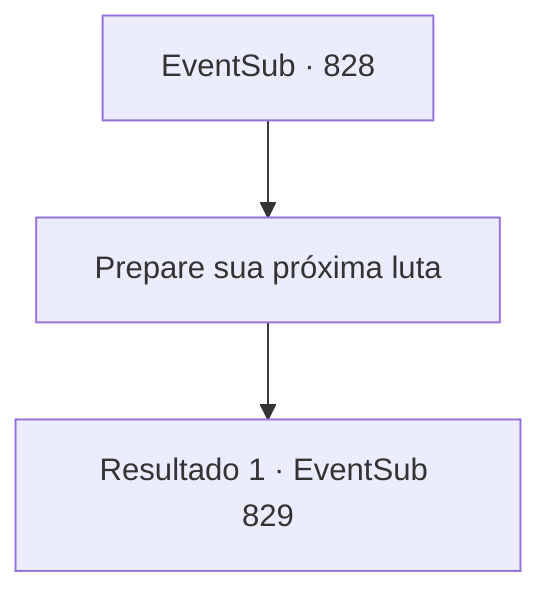

# Eventos secundários · 828

[Índice da tabela](index.md) · [Índice geral](../index.md)

ID: `pt:EventSub:828` · Fonte: `EventSub4` · Versão: 1.2.47.

Mapeamento estático dos arquivos; a disponibilidade e a execução dependem do estado da run.

## Texto do evento

*Sem texto no arquivo.*

## Dados de entrada

```json
{
  "id": 828,
  "grade": 1,
  "subEvent": "",
  "required": ""
}
```

## Mapa das escolhas



## Escolhas e resultados

### Escolha 1

Prepare sua próxima luta

Requisitos e outros campos da escolha:

```json
{
  "required": ""
}
```

#### Resultado 1.1

Você se descontrai, se preparando para a próxima partida. 

 Logo, você se prepara e entra na arena. A excitação do público está no auge. Eles estão gritando seu nome e o do seu oponente repetidamente. Usando a torcida como combustível, você se prepara para lutar. Seu oponente, que estava no palco antes de você, o cumprimenta em um tom formal. 

 "O nome é Sparkles, companheiro aventureiro! Eu venho do grande Reino de Lothar. Vamos ter uma luta honrada e justa."

 O homem está equipado com uma armadura completa e empunha uma enorme alabarda. Logo, a enorme arma balança em sua direção enquanto a partida final começa.

Continuação registrada: [Evento 829](0829.md) na mesma tabela.

```json
{
  "required": "",
  "chance": "1",
  "nextEvent": 829,
  "type": 2,
  "reward": "6_0_180",
  "place": 11
}
```

## Referências que chegam a este evento

- [Evento 827 · escolha 1 · resultado 1](0827.md#escolha-1)
