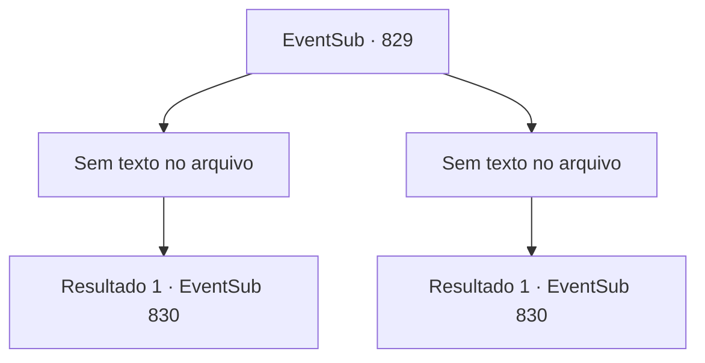

# Eventos secundários · 829

[Índice da tabela](index.md) · [Índice geral](../index.md)

ID: `pt:EventSub:829` · Fonte: `EventSub4` · Versão: 1.2.47.

Mapeamento estático dos arquivos; a disponibilidade e a execução dependem do estado da run.

## Texto do evento

*Sem texto no arquivo.*

## Dados de entrada

```json
{
  "id": 829,
  "grade": 1,
  "subEvent": "",
  "required": ""
}
```

## Mapa das escolhas



## Escolhas e resultados

### Escolha 1

*Sem texto no arquivo; o papel dessa opção depende da interface do jogo.*

Requisitos e outros campos da escolha:

```json
{
  "required": ""
}
```

#### Resultado 1.1

Uma brisa suave enche a arena. Você recupera o fôlego e levanta sua arma bem alto. Deitado no chão, Sir Sparkles admite a derrota amargamente. 

 "Eu... perdi..."

 Seu nome ecoa pela arena. Você é o vencedor do torneio! A cidade inteira parece tremer com a celebração. 

 "O novo Mestre de Batalha é... {1}!!"

 O Sultão de Gladio e o Sumo Sacerdote de Batt levantam seus braços no ar, declarando sua vitória. Junto com o título vem um prêmio em dinheiro considerável, e você é aplaudido e adorado pela multidão. Você acena para responder aos seus favores. Com o torneio terminado, você não tem mais razão para estar na arena. Você sai para as ruas, para encontrar os locais aproveitando as festividades.

Continuação registrada: [Evento 830](0830.md) na mesma tabela.

```json
{
  "required": "",
  "chance": "1",
  "nextEvent": 830,
  "type": 2,
  "reward": "1_4_300|1_5_1"
}
```

### Escolha 2

*Sem texto no arquivo; o papel dessa opção depende da interface do jogo.*

Requisitos e outros campos da escolha:

```json
{
  "required": ""
}
```

#### Resultado 2.1

Uma brisa suave enche a arena. Sir Sparkles ruge triunfantemente, balançando sua alabarda. Você desaba no palco. Você perdeu. <link=shake>

 "WOOOOOOOOO!!!"

</link> O nome de Sir Sparkles ecoa pela arena. A cidade inteira parece estar tremendo com a celebração. 

 "O novo Mestre de Batalha é... Sir Sparkles do Reino de Lothar!"

 O Sultão de Gladio e o Sumo Sacerdote de Batt levantam seus braços no ar, declarando sua vitória. Com o torneio terminado, você não tem mais razão para estar na arena. Você sai para as ruas, para encontrar os locais aproveitando as festividades.

Continuação registrada: [Evento 830](0830.md) na mesma tabela.

```json
{
  "required": "",
  "chance": "1",
  "nextEvent": 830,
  "type": 2,
  "reward": ""
}
```

## Referências que chegam a este evento

- [Evento 828 · escolha 1 · resultado 1](0828.md#escolha-1)
