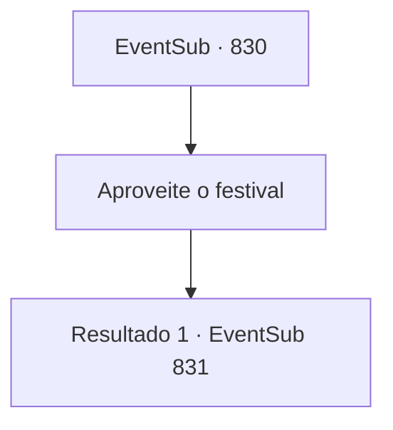

# Eventos secundários · 830

[Índice da tabela](index.md) · [Índice geral](../index.md)

ID: `pt:EventSub:830` · Fonte: `EventSub4` · Versão: 1.2.47.

Mapeamento estático dos arquivos; a disponibilidade e a execução dependem do estado da run.

## Texto do evento

*Sem texto no arquivo.*

## Dados de entrada

```json
{
  "id": 830,
  "grade": 1,
  "subEvent": "",
  "required": ""
}
```

## Mapa das escolhas



## Escolhas e resultados

### Escolha 1

Aproveite o festival

Requisitos e outros campos da escolha:

```json
{
  "required": ""
}
```

#### Resultado 1.1

Enquanto você está ocupado passeando pelas festividades na rua, você se depara com uma mulher. Ela se apresenta como uma sacerdotisa de Veene, a deusa do amor e da misericórdia, e diz que tem algo para você. 

 "Isto é... uma lembrança de Lei Ryu. É seu. Por favor, aceite."


Continuação registrada: [Evento 831](0831.md) na mesma tabela.

```json
{
  "required": "",
  "chance": "1",
  "nextEvent": 831,
  "type": 2,
  "reward": "3_323_1"
}
```

## Referências que chegam a este evento

- [Evento 822 · escolha 2 · resultado 2](0822.md#escolha-2)
- [Evento 825 · escolha 2 · resultado 2](0825.md#escolha-2)
- [Evento 827 · escolha 2 · resultado 1](0827.md#escolha-2)
- [Evento 829 · escolha 1 · resultado 1](0829.md#escolha-1)
- [Evento 829 · escolha 2 · resultado 1](0829.md#escolha-2)
