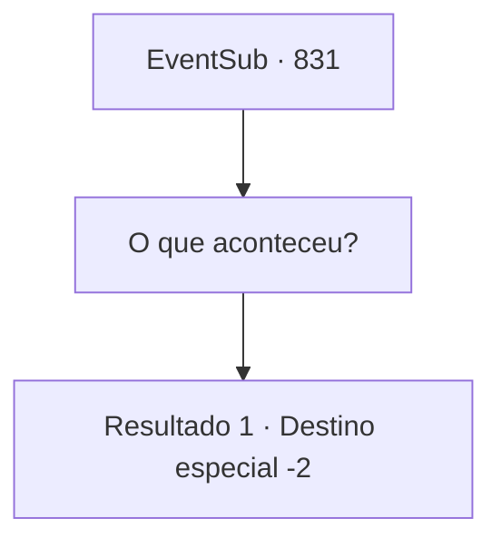

# Eventos secundários · 831

[Índice da tabela](index.md) · [Índice geral](../index.md)

ID: `pt:EventSub:831` · Fonte: `EventSub4` · Versão: 1.2.47.

Mapeamento estático dos arquivos; a disponibilidade e a execução dependem do estado da run.

## Texto do evento

*Sem texto no arquivo.*

## Dados de entrada

```json
{
  "id": 831,
  "grade": 1,
  "subEvent": "",
  "required": ""
}
```

## Mapa das escolhas



## Escolhas e resultados

### Escolha 1

O que aconteceu?

Requisitos e outros campos da escolha:

```json
{
  "required": ""
}
```

#### Resultado 1.1

Você pede à sacerdotisa de Veene uma explicação. Ela solta um longo suspiro e começa a falar. 

 "Ele veio ao nosso tabernáculo há apenas alguns dias. Queria um lugar para meditar e treinar em solidão, para se preparar para o Torneio de Lutadores de Battra."

 O problema começou cerca de três dias depois. De repente, durante o treinamento, Lei vomitou sangue e desmaiou. A sacerdotisa acrescenta que fez tudo ao seu alcance para ajudá-lo, mas suas condições estavam além da recuperação. 

 "Fiz algumas pesquisas. Eles chamam de 'Desvio de Ki' no Oriente. Honestamente, eu pessoalmente não classificaria isso como uma doença, porque as causas e os sintomas variam muito... Mas de qualquer forma, uh... não havia nada que eu pudesse fazer."

 Por que seu Ki desviou em primeiro lugar, a sacerdotisa não tinha ideia. A única coisa que você poderia fazer é supor que Lei passou por algo muito perigoso. A sacerdotisa murmura uma oração por Lei mais uma vez e parte. Você aperta o amuleto de Lei, olhando para ele.

Continuação registrada: [Destino especial `-2`](../destinos-especiais.md).

```json
{
  "required": "",
  "chance": "1",
  "nextEvent": -2,
  "type": 2,
  "reward": "12_11_-1|14_11_9"
}
```

## Referências que chegam a este evento

- [Evento 830 · escolha 1 · resultado 1](0830.md#escolha-1)
