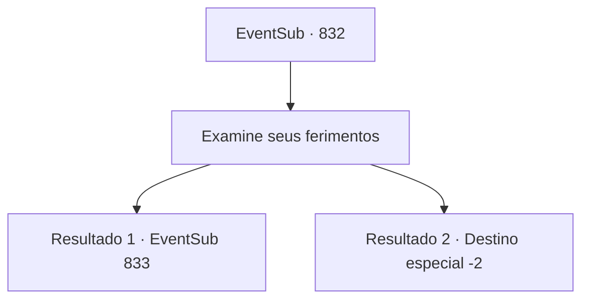

# Eventos secundários · 832

[Índice da tabela](index.md) · [Índice geral](../index.md)

ID: `pt:EventSub:832` · Fonte: `EventSub4` · Versão: 1.2.47.

Mapeamento estático dos arquivos; a disponibilidade e a execução dependem do estado da run.

## Texto do evento

*Sem texto no arquivo.*

## Dados de entrada

```json
{
  "id": 832,
  "grade": 1,
  "subEvent": "",
  "required": ""
}
```

## Mapa das escolhas



## Escolhas e resultados

### Escolha 1

Examine seus ferimentos

Requisitos e outros campos da escolha:

```json
{
  "required": ""
}
```

#### Resultado 1.1

Você examina cuidadosamente a condição de Lei. Não há sinais visíveis, mas você mal sente seu pulso, sem mencionar que a temperatura do corpo dele está caindo rapidamente. 

 "Aparentemente, eles chamam isso de 'Desvio de Ki' no Oriente."

 A sacerdotisa acrescenta. Felizmente, você sabe como lidar com Ki. Você se lembra de que, para curar alguém de Desvio de Ki, deve liberar cuidadosamente um pouco da essência mágica, redirecionando-a para restaurar sua circulação.

Continuação registrada: [Evento 833](0833.md) na mesma tabela.

```json
{
  "required": "20_106_1",
  "chance": "1",
  "nextEvent": 833,
  "type": 2,
  "reward": "5_732_1"
}
```

#### Resultado 1.2

Você examina cuidadosamente a condição de Lei, mas não consegue identificar nada fora do comum. 

 "Aparentemente, eles chamam isso de 'Desvio de Ki' no Oriente."

 A sacerdotisa acrescenta. Mesmo com sua informação extra, você não tem ideia de por onde começar o tratamento. Lei finalmente abre os olhos e olha para você. 

 "...É você, Sohyeop...? Como você..."

 Lei agarra suas mãos com força. Sua tez está pálida e exausta. 

 "...Sohyeop... Por favor... Pegue... minha espada. Meu... símbolo de gratidão..."

 Com isso, Lei fecha os olhos. 

 "...Ele se foi."

 A sacerdotisa declara a morte de Lei. Você solta suas mãos e sai da sala. Logo, a sacerdotisa o segue para fora. Ela diz que um pequeno funeral será realizado nos terrenos do tabernáculo, e o corpo será enterrado no cemitério. 

 "Este é o seu souvenir. Acho que você deveria ser o único a levá-lo."

 Ela lhe dá algumas palavras de consolo, assegurando que a morte dele não foi sua culpa. Você segura a lembrança de Lei em suas mãos e a encara silenciosamente.

Continuação registrada: [Destino especial `-2`](../destinos-especiais.md).

```json
{
  "required": "21_106_1",
  "chance": "1",
  "nextEvent": -2,
  "type": 2,
  "reward": "3_323_1|12_11_-1|14_11_9"
}
```

## Referências que chegam a este evento

- [Evento 824 · escolha 2 · resultado 1](0824.md#escolha-2)
- [Evento 825 · escolha 2 · resultado 1](0825.md#escolha-2)
