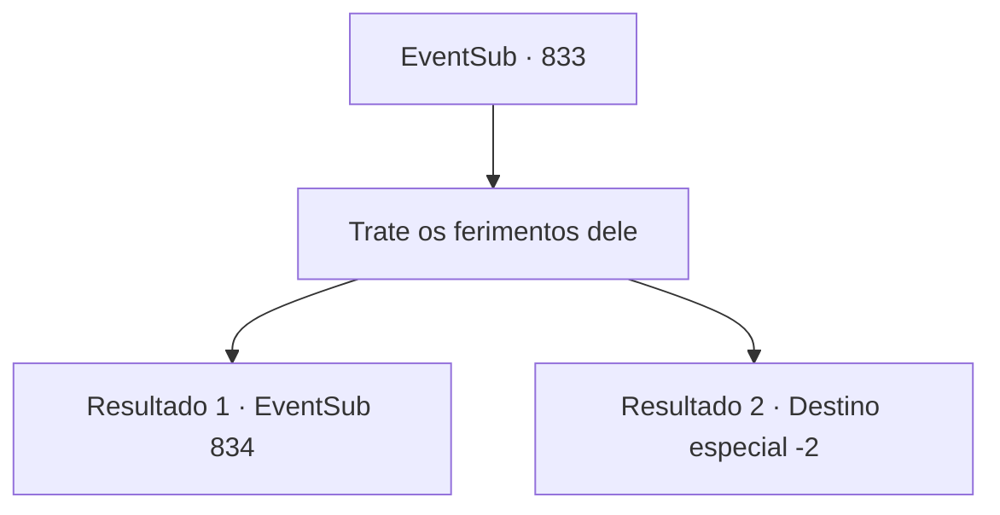

# Eventos secundários · 833

[Índice da tabela](index.md) · [Índice geral](../index.md)

ID: `pt:EventSub:833` · Fonte: `EventSub4` · Versão: 1.2.47.

Mapeamento estático dos arquivos; a disponibilidade e a execução dependem do estado da run.

## Texto do evento

*Sem texto no arquivo.*

## Dados de entrada

```json
{
  "id": 833,
  "grade": 1,
  "subEvent": "",
  "required": ""
}
```

## Mapa das escolhas



## Escolhas e resultados

### Escolha 1

Trate os ferimentos dele

Requisitos e outros campos da escolha:

```json
{
  "required": "5_732_1"
}
```

#### Resultado 1.1

Você libera um pouco da sua própria essência, deixando-a fluir para Lei. O tratamento leva quatro dias inteiros. 

 "...Hã? Onde estou - O QUÊ? SOHYEOP?!"

 Lei parece estar em boa forma novamente. Seu tratamento deve ter sido eficaz. Ele ainda parece confuso, no entanto. Você tenta acalmá-lo e pergunta como ele está se sentindo. Lei se examina, respira fundo e responde. 

 "O- obrigado, Sohyeop. Acho que estou... bem agora."


Continuação registrada: [Evento 834](0834.md) na mesma tabela.

```json
{
  "required": "",
  "chance": "1|0_12_1|0_14_1",
  "nextEvent": 834,
  "type": 0,
  "reward": ""
}
```

#### Resultado 1.2

Você libera um pouco da sua própria essência, deixando-a fluir para Lei. Mas no estado atual de Lei, ele é incapaz de suportar até o menor impacto. Lei responde à sua essência vomitando sangue. 

 "...É você, Sohyeop...? Como você...?"

 Lei agarra suas mãos com força. Sua tez está pálida e exausta. 

 "...Sohyeop... Por favor... Pegue... minha espada. Meu... símbolo de gratidão..."

 Com isso, Lei fecha os olhos. 

 "...Ele se foi."

 A sacerdotisa declara a morte de Lei. Você solta as mãos dele e sai da sala. Logo, a sacerdotisa o segue para fora. Ela diz que um pequeno funeral será realizado nos terrenos do tabernáculo, e o corpo será enterrado no cemitério. 

 "Este é o seu souvenir. Acho que você deveria ser o único a levá-lo."

 Ela lhe dá algumas palavras de consolo, assegurando que a morte dele não foi sua culpa. Você segura a lembrança de Lei em suas mãos e a encara silenciosamente.

Continuação registrada: [Destino especial `-2`](../destinos-especiais.md).

```json
{
  "required": "",
  "chance": "40",
  "nextEvent": -2,
  "type": 1,
  "reward": "3_323_1|12_11_-1|14_11_9"
}
```

## Referências que chegam a este evento

- [Evento 832 · escolha 1 · resultado 1](0832.md#escolha-1)
