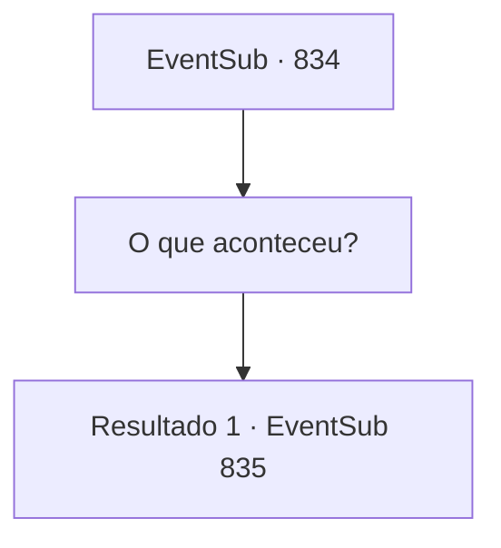

# Eventos secundários · 834

[Índice da tabela](index.md) · [Índice geral](../index.md)

ID: `pt:EventSub:834` · Fonte: `EventSub4` · Versão: 1.2.47.

Mapeamento estático dos arquivos; a disponibilidade e a execução dependem do estado da run.

## Texto do evento

*Sem texto no arquivo.*

## Dados de entrada

```json
{
  "id": 834,
  "grade": 1,
  "subEvent": "",
  "required": ""
}
```

## Mapa das escolhas



## Escolhas e resultados

### Escolha 1

O que aconteceu?

Requisitos e outros campos da escolha:

```json
{
  "required": ""
}
```

#### Resultado 1.1

Você pergunta a Lei o que aconteceu. Ele simplesmente olha para o teto, então toma uma decisão. 

 "...Desde que Shao morreu, eu senti algo preso na minha mente. Um fardo que simplesmente não ia embora. Aparentemente, eu não deveria ter tentado treinar nessa condição... devo ter caído em Derivação de Ki."

 Lei fica em silêncio após explicar. Então, ele olha nos seus olhos sem vida e faz uma pergunta. 

 "Sohyeop. O que devo fazer agora? O que posso fazer para me livrar desta... consciência culpada?"


Continuação registrada: [Evento 835](0835.md) na mesma tabela.

```json
{
  "required": "",
  "chance": "1",
  "nextEvent": 835,
  "type": 2,
  "reward": ""
}
```

## Referências que chegam a este evento

- [Evento 833 · escolha 1 · resultado 1](0833.md#escolha-1)
