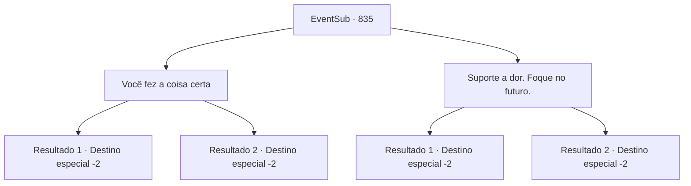

# Eventos secundários · 835

[Índice da tabela](index.md) · [Índice geral](../index.md)

ID: `pt:EventSub:835` · Fonte: `EventSub4` · Versão: 1.2.47.

Mapeamento estático dos arquivos; a disponibilidade e a execução dependem do estado da run.

## Texto do evento

*Sem texto no arquivo.*

## Dados de entrada

```json
{
  "id": 835,
  "grade": 1,
  "subEvent": "",
  "required": ""
}
```

## Mapa das escolhas



## Escolhas e resultados

### Escolha 1

Você fez a coisa certa

Requisitos e outros campos da escolha:

```json
{
  "required": ""
}
```

#### Resultado 1.1

Você tranquiliza Lei dizendo que Shao mereceu o que aconteceu com ela. Lei te escuta por um momento antes de concordar com um aceno de cabeça. 

 "Obrigado, Sohyeop. Isso me faz sentir um pouco melhor. Devo pensar em retornar ao meu clã."

 A sacerdotisa o impede de falar, lembrando-o de que sua prioridade deve ser descansar. Expulso do quarto pela sacerdotisa, você se despede de Lei e sai.  

 Na manhã seguinte, enquanto você se prepara para partir do tabernáculo, encontra Lei. Ele se curva para você e lhe entrega um vestido de seda cuidadosamente dobrado. 

 "Este é um símbolo de gratidão, por tudo. Quero que você o tenha."

 É uma luxuosa vestimenta oriental. Uma imagem de um dragão está lindamente bordada na seda alabastrina, como se estivesse nadando em um mar de nuvens. 

 "É chamado de Manto do Dragão. Eu o recebi como um presente do Chefe do Clã, mas... quero dar a você, Sohyeop."

 Lei faz a saudação oriental como um sinal de despedida, prometendo se encontrar novamente no futuro, caso os caminhos se cruzem.

Continuação registrada: [Destino especial `-2`](../destinos-especiais.md).

```json
{
  "required": "",
  "chance": "1|0_12_1",
  "nextEvent": -2,
  "type": 2,
  "reward": "3_324_1|12_11_-1|14_11_17"
}
```

#### Resultado 1.2

Você assegura a Lei que Shao mereceu o que recebeu. Ele não parece tão convencido, mas ainda assim acena com a cabeça. Lei cai mais uma vez em um silêncio momentâneo. 

 "...Ok. Eu deveria pensar em voltar para o meu clã. Afinal, o torneio acabou."

 A sacerdotisa o impede de falar, lembrando-o de que sua prioridade deve ser descansar. Expulso do quarto pela sacerdotisa, você se despede de Lei e sai.  

 Na manhã seguinte, enquanto você se prepara para partir do tabernáculo, encontra Lei. Ele se inclina para você e lhe entrega um vestido de seda cuidadosamente dobrado. 

 "Este é um símbolo de gratidão, por tudo. Quero que você o tenha."

 É uma luxuosa vestimenta oriental. Uma imagem de um dragão está lindamente bordada na seda alabastrina, como se estivesse nadando em um mar de nuvens. 

 "É chamado de Manto do Dragão. Eu o recebi como um presente do Chefe do Clã, mas... quero dar a você, Sohyeop."

 Lei faz a saudação oriental como um sinal de despedida, prometendo se encontrar novamente no futuro, caso os caminhos se cruzem.

Continuação registrada: [Destino especial `-2`](../destinos-especiais.md).

```json
{
  "required": "",
  "chance": "20",
  "nextEvent": -2,
  "type": 2,
  "reward": "3_324_1|12_11_-1|14_11_9"
}
```

### Escolha 2

Suporte a dor. Foque no futuro.

Requisitos e outros campos da escolha:

```json
{
  "required": ""
}
```

#### Resultado 2.1

Você diz a Lei para suportar a dor da perda e focar no futuro, sobre o que ele vai fazer agora. Os olhos de Lei de repente ficam vermelhos. Lágrimas começam a cair por suas bochechas. 

 "Entendo. Obrigado pela lição de vida, Sohyeop... Devo pensar em retornar ao meu clã."

 A sacerdotisa o impede de falar, lembrando-o de que sua prioridade deve ser descansar. Expulso do quarto pela sacerdotisa, você se despede de Lei e sai.  

 Na manhã seguinte, enquanto você se prepara para partir do tabernáculo, encontra Lei. Ele se curva para você e lhe entrega um vestido de seda cuidadosamente dobrado. 

 "Este é um símbolo de gratidão, por tudo. Quero que você o tenha."

 É uma luxuosa vestimenta oriental. Uma imagem de um dragão está lindamente bordada na seda alabastrina, como se estivesse nadando em um mar de nuvens. 

 "É chamado de Manto do Dragão. Eu o recebi como um presente do Chefe do Clã, mas... quero dar a você, Sohyeop."

 Lei faz a saudação oriental como um sinal de despedida, prometendo se encontrar novamente no futuro, caso os caminhos se cruzem.

Continuação registrada: [Destino especial `-2`](../destinos-especiais.md).

```json
{
  "required": "",
  "chance": "1|0_7_1",
  "nextEvent": -2,
  "type": 2,
  "reward": "3_324_1|12_11_-1|14_11_17"
}
```

#### Resultado 2.2

Você diz a Lei para suportar a dor da perda e focar no futuro, no que ele vai fazer agora. Ele não parece tão convencido, mas ainda assim acena com a cabeça. Lei cai mais uma vez em um silêncio momentâneo. 

 "...Ok. Eu devo pensar em retornar ao meu clã. Afinal, o torneio acabou."

 A sacerdotisa o impede de falar, lembrando-o de que sua prioridade deve ser descansar. Expulso do quarto pela sacerdotisa, você se despede de Lei e sai.  

 Na manhã seguinte, enquanto você se prepara para partir do tabernáculo, encontra Lei. Ele se inclina para você e lhe entrega um vestido de seda cuidadosamente dobrado. 

 "Este é um símbolo de gratidão, por tudo. Quero que você o tenha."

 É uma vestimenta oriental luxuosa. Uma imagem de um dragão está lindamente bordada na seda alabastrina, como se estivesse nadando em um mar de nuvens. 

 "É chamado de Manto do Dragão. Eu o recebi como um presente do Chefe do Clã, mas... quero dar a você, Sohyeop."

 Lei faz a saudação oriental como um sinal de despedida, prometendo se encontrar novamente no futuro, caso os caminhos se cruzem.

Continuação registrada: [Destino especial `-2`](../destinos-especiais.md).

```json
{
  "required": "",
  "chance": "20",
  "nextEvent": -2,
  "type": 2,
  "reward": "3_324_1|12_11_-1|14_11_9"
}
```

## Referências que chegam a este evento

- [Evento 834 · escolha 1 · resultado 1](0834.md#escolha-1)
