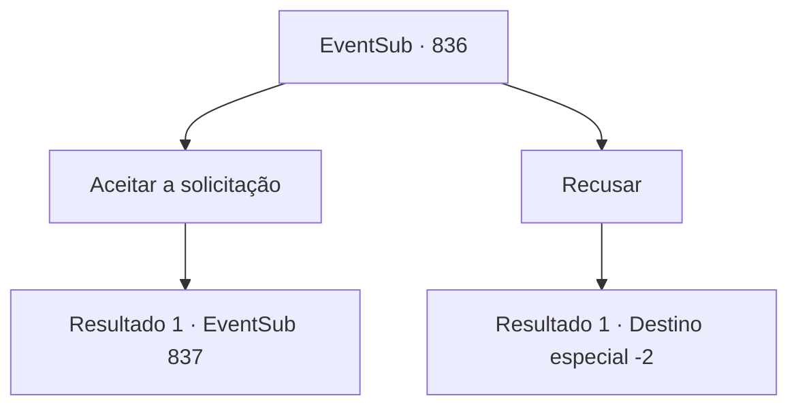

# Eventos secundários · 836

[Índice da tabela](index.md) · [Índice geral](../index.md)

ID: `pt:EventSub:836` · Fonte: `EventSub4` · Versão: 1.2.47.

Mapeamento estático dos arquivos; a disponibilidade e a execução dependem do estado da run.

## Texto do evento

A cidade costeira em que você acabou de chegar não é necessariamente enorme, mas está exultante graças à população local trabalhadora. Como seria de se esperar de qualquer assentamento localizado perto do oceano, a maioria dos habitantes da cidade eram pescadores. Os homens saíam para o mar com seus barcos de pesca, então as mulheres transformavam o peixe em algo comestível e o vendiam no mercado. Uma comerciante de meia-idade se aproxima de você e fala. 

 "Ei, uh... Isso é apenas um boato, mas aparentemente algumas pessoas estão ouvindo barulhos estranhos vindos da enseada. Linguagem inaudível e gritos... e coisas do tipo. Os habitantes da cidade estão ficando preocupados. Se tivermos que lidar com uma sereia ou uma maldita bruxa do mar..."

 O problema é que ninguém na cidade foi corajoso o suficiente para verificar o barulho. Eles estão todos usando sua agenda de trabalho ocupada como desculpa. A fonte foi deixada sem verificação por cerca de um mês agora. 

 "Talvez eu possa pedir para você verificar, hm?  Vamos, vou jogar um pouco da pesca para você."


## Dados de entrada

```json
{
  "id": 836,
  "grade": 1,
  "subEvent": "",
  "required": "12_11_8"
}
```

## Mapa das escolhas



## Escolhas e resultados

### Escolha 1

Aceitar a solicitação

Requisitos e outros campos da escolha:

```json
{
  "required": ""
}
```

#### Resultado 1.1

O comerciante lhe entrega uma cavala fresca e fala. 

 "Vê aquele penhasco ali? Sons estranhos vieram da caverna abaixo dele..."

 Você pega a cavala e se dirige à fonte do terror. 

 Como o comerciante mencionou, a caverna está localizada na borda da enseada, abaixo de um penhasco íngreme. Você faz o melhor para não escorregar no chão molhado e entra na caverna escura. Cheira a úmido e salgado aqui dentro. Raios fracos de luz solar entram por pequenas frestas no teto. Você avança mais fundo para explorar. No centro de uma cavidade, você nota vestígios de uma fogueira. Você olha ao redor e deduz que alguém tem vivido aqui. Nesse momento, alguém corre em sua direção por trás e o ataca com uma espada.

Continuação registrada: [Evento 837](0837.md) na mesma tabela.

```json
{
  "required": "",
  "chance": "1",
  "nextEvent": 837,
  "type": 2,
  "reward": "3_124_1"
}
```

### Escolha 2

Recusar

Requisitos e outros campos da escolha:

```json
{
  "required": ""
}
```

#### Resultado 2.1

Você ignora o pedido do comerciante e deixa a cidade costeira. Você ouve algumas palavras maldosas às suas costas, mas isso não te incomoda muito.

Continuação registrada: [Destino especial `-2`](../destinos-especiais.md).

```json
{
  "required": "",
  "chance": "1",
  "nextEvent": -2,
  "type": 2,
  "reward": "12_11_-1"
}
```

## Referências que chegam a este evento

Nenhum `nextEvent` positivo da mesma tabela aponta para este nó. Isso não prova que seja inacessível: sorteio e estado de história podem selecioná-lo.

