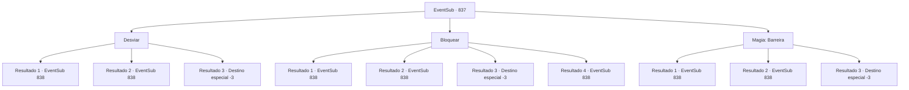

# Eventos secundários · 837

[Índice da tabela](index.md) · [Índice geral](../index.md)

ID: `pt:EventSub:837` · Fonte: `EventSub4` · Versão: 1.2.47.

Mapeamento estático dos arquivos; a disponibilidade e a execução dependem do estado da run.

## Texto do evento

*Sem texto no arquivo.*

## Dados de entrada

```json
{
  "id": 837,
  "grade": 1,
  "subEvent": "",
  "required": ""
}
```

## Mapa das escolhas



## Escolhas e resultados

### Escolha 1

Desviar 

Requisitos e outros campos da escolha:

```json
{
  "required": ""
}
```

#### Resultado 1.1

Você rapidamente se afasta do curso do ataque para identificar o atacante. Você imediatamente reconhece o oriental com um rosto familiar. O atacante deve ter te reconhecido também, pois ele embainha sua espada também. O rosto de Lei escurece com confusão e surpresa. 

 "...Sohyeop? Eu- Eu sinto muito! Eu te confundi com um perseguidor, eu -...!"


Continuação registrada: [Evento 838](0838.md) na mesma tabela.

```json
{
  "required": "",
  "chance": "1|0_6_1",
  "nextEvent": 838,
  "type": 0,
  "reward": ""
}
```

#### Resultado 1.2

Você tenta se desviar do ataque, mas não foi rápido o suficiente. Segurando firmemente o ferimento fresco para diminuir o sangramento, você se vira para identificar o atacante. Você imediatamente reconhece o oriental com um rosto familiar. O atacante deve ter te reconhecido também, pois ele embainha sua espada. O rosto de Lei escurece com confusão e surpresa. 

 "...Sohyeop? Eu- Eu sinto muito! Eu te confundi com um perseguidor, eu -...!"


Continuação registrada: [Evento 838](0838.md) na mesma tabela.

```json
{
  "required": "1_0_2",
  "chance": "16",
  "nextEvent": 838,
  "type": 1,
  "reward": "0_0_-1"
}
```

#### Resultado 1.3

Você tenta se desviar do ataque, mas não foi rápido o suficiente. Você dá uma última olhada no atacante antes de cair no chão. Ele também está te examinando, depois de desembainhar sua espada. O rosto de Lei se obscurece com confusão e surpresa, mas é tarde demais. 

 "...Sohyeop?! NÃO!! SOHYEOP!!"

 Você não consegue responder a ele. Lentamente, sua visão escurece. Logo, tudo fica completamente escuro.

Continuação registrada: [Destino especial `-3`](../destinos-especiais.md).

```json
{
  "required": "2_0_2",
  "chance": "16",
  "nextEvent": -3,
  "type": 1,
  "reward": "0_0_-1"
}
```

### Escolha 2

Bloquear

Requisitos e outros campos da escolha:

```json
{
  "required": "20_9_1"
}
```

#### Resultado 2.1

Você habilmente bloqueia o ataque para identificar o atacante. Você imediatamente reconhece o oriental com um rosto familiar. O atacante deve ter te reconhecido também, pois ele embainha sua espada também. O rosto de Lei escurece com confusão e surpresa. 

 "...Sohyeop? E- Eu sinto muito! Eu te confundi com um perseguidor, eu -...!"


Continuação registrada: [Evento 838](0838.md) na mesma tabela.

```json
{
  "required": "21_9_4",
  "chance": "1|0_6_1",
  "nextEvent": 838,
  "type": 0,
  "reward": ""
}
```

#### Resultado 2.2

Você tenta bloquear o ataque, mas não foi rápido o suficiente. Segurando firmemente o ferimento fresco para desacelerar o sangramento, você se vira para identificar o atacante. Você imediatamente reconhece o oriental com um rosto familiar. O atacante deve ter te reconhecido também, pois ele embainha sua espada. O rosto de Lei escurece com confusão e surpresa. 

 "...Sohyeop? Eu- Eu sinto muito! Eu te confundi com um perseguidor, eu -...!"


Continuação registrada: [Evento 838](0838.md) na mesma tabela.

```json
{
  "required": "21_9_4|1_0_2",
  "chance": "16",
  "nextEvent": 838,
  "type": 1,
  "reward": "0_0_-1"
}
```

#### Resultado 2.3

Você tenta bloquear o ataque, mas não foi rápido o suficiente. Você dá uma última olhada no atacante antes de cair no chão. Ele também está te examinando, depois de desembainhar sua espada. O rosto de Lei se obscurece com confusão e surpresa, mas é tarde demais. 

 "...Sohyeop?! NÃO!! SOHYEOP!!"

 Você não consegue responder a ele. Lentamente, sua visão escurece. Logo, tudo fica completamente escuro.

Continuação registrada: [Destino especial `-3`](../destinos-especiais.md).

```json
{
  "required": "21_9_4|2_0_2",
  "chance": "16",
  "nextEvent": -3,
  "type": 1,
  "reward": "0_0_-1"
}
```

#### Resultado 2.4

Você habilmente bloqueia o ataque para identificar o atacante. Você imediatamente reconhece o oriental com um rosto familiar. O atacante deve ter te reconhecido também, pois ele embainha sua espada também. O rosto de Lei escurece com confusão e surpresa. 

 "...Sohyeop? E- Eu sinto muito! Eu te confundi com um perseguidor, eu -...!"


Continuação registrada: [Evento 838](0838.md) na mesma tabela.

```json
{
  "required": "20_9_4",
  "chance": "1",
  "nextEvent": 838,
  "type": 2,
  "reward": ""
}
```

### Escolha 3

Magia: Barreira

Requisitos e outros campos da escolha:

```json
{
  "required": "20_0_1|1_1_2"
}
```

#### Resultado 3.1

Você conjura uma barreira, bloqueia o ataque e identifica o atacante. Você imediatamente reconhece o oriental com um rosto familiar. O atacante deve ter te reconhecido também, pois ele embainha sua espada. O rosto de Lei escurece com confusão e surpresa. 

 "...Sohyeop? Eu- Eu sinto muito! Eu te confundi com um perseguidor, eu -...!"


Continuação registrada: [Evento 838](0838.md) na mesma tabela.

```json
{
  "required": "",
  "chance": "1|0_7_1",
  "nextEvent": 838,
  "type": 0,
  "reward": "0_1_-1"
}
```

#### Resultado 3.2

Você tenta conjurar uma barreira e bloquear o ataque, mas não foi rápido o suficiente. Segurando firmemente o ferimento fresco para desacelerar o sangramento, você se vira para identificar o atacante. Você imediatamente reconhece o oriental com um rosto familiar. O atacante deve ter te reconhecido também, pois ele embainha sua espada. O rosto de Lei escurece com confusão e surpresa. 

 "...Sohyeop? Eu- Eu sinto muito! Eu te confundi com um perseguidor, eu -...!"


Continuação registrada: [Evento 838](0838.md) na mesma tabela.

```json
{
  "required": "1_0_2",
  "chance": "16",
  "nextEvent": 838,
  "type": 1,
  "reward": "0_0_-1"
}
```

#### Resultado 3.3

Você tenta conjurar uma barreira e bloquear o ataque, mas não foi rápido o suficiente.   Você dá uma última olhada no atacante antes de cair no chão.   Ele também está te examinando, depois de desembainhar sua espada.   O rosto de Lei escurece com confusão e surpresa, mas é tarde demais.   

 "...Sohyeop?! NÃO!! SOHYEOP!!"

   Você não consegue respondê-lo. Lentamente, sua visão escurece.   Logo, tudo fica completamente escuro.

Continuação registrada: [Destino especial `-3`](../destinos-especiais.md).

```json
{
  "required": "2_0_2",
  "chance": "16",
  "nextEvent": -3,
  "type": 1,
  "reward": "0_0_-1"
}
```

## Referências que chegam a este evento

- [Evento 836 · escolha 1 · resultado 1](0836.md#escolha-1)
