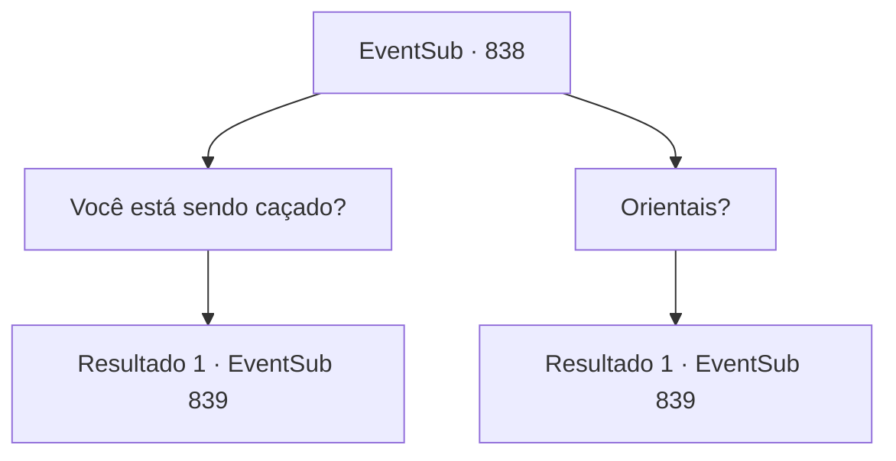

# Eventos secundários · 838

[Índice da tabela](index.md) · [Índice geral](../index.md)

ID: `pt:EventSub:838` · Fonte: `EventSub4` · Versão: 1.2.47.

Mapeamento estático dos arquivos; a disponibilidade e a execução dependem do estado da run.

## Texto do evento

*Sem texto no arquivo.*

## Dados de entrada

```json
{
  "id": 838,
  "grade": 1,
  "subEvent": "",
  "required": ""
}
```

## Mapa das escolhas



## Escolhas e resultados

### Escolha 1

Você está sendo caçado?

Requisitos e outros campos da escolha:

```json
{
  "required": ""
}
```

#### Resultado 1.1

Lei cuidadosamente lhe conta tudo em resposta. 

 "Na verdade... depois que nos separamos, Sohyeop, fui emboscado. Pela legítima herdeira do Clã Ryu, 'Shao Ryu', e seu leal grupo de guerreiros, os Dragões Vermelhos."

 Lei solta um breve suspiro e continua. 

 "Exatamente por que fui emboscado, não posso dizer. Só tenho minhas próprias suposições..."

 Segundo Lei, ele conseguiu escapar, mas as perseguições continuaram, e ele não teve escolha a não ser se esconder. O que fez da caverna em que vocês dois estão agora seu esconderijo. Depois de terminar sua explicação, Lei pede desculpas mais uma vez por ter atacado você. Ele dá uma olhada na área fora da caverna e fala. 

 "A propósito, o que você está fazendo aqui, Sohyeop? Se me permite perguntar?"


Continuação registrada: [Evento 839](0839.md) na mesma tabela.

```json
{
  "required": "",
  "chance": "1",
  "nextEvent": 839,
  "type": 2,
  "reward": ""
}
```

### Escolha 2

Orientais?

Requisitos e outros campos da escolha:

```json
{
  "required": ""
}
```

#### Resultado 2.1

Os olhos de Lei se arregalam - ele parece surpreso ao ouvir sua pergunta. 

 "V-você está certo. Depois que nos separamos, Sohyeop, fui emboscado. Pela herdeira legítima do Clã Ryu, 'Shao Ryu', e seu leal grupo de guerreiros, os Dragões Vermelhos."

 Lei solta um breve suspiro e continua. 

 "Exatamente por que fui emboscado, não posso dizer. Só tenho minhas próprias suposições..."

 Segundo Lei, ele conseguiu escapar, mas as perseguições continuaram, e ele não teve escolha a não ser se esconder. O que fez da caverna em que vocês dois estão agora seu esconderijo. Depois de terminar sua explicação, Lei pede desculpas mais uma vez por ter atacado você. Ele olha para a área fora da caverna e fala. 

 "A propósito, o que você está fazendo aqui, Sohyeop? Se me permite perguntar?"


Continuação registrada: [Evento 839](0839.md) na mesma tabela.

```json
{
  "required": "",
  "chance": "1",
  "nextEvent": 839,
  "type": 2,
  "reward": ""
}
```

## Referências que chegam a este evento

- [Evento 837 · escolha 1 · resultado 1](0837.md#escolha-1)
- [Evento 837 · escolha 1 · resultado 2](0837.md#escolha-1)
- [Evento 837 · escolha 2 · resultado 1](0837.md#escolha-2)
- [Evento 837 · escolha 2 · resultado 2](0837.md#escolha-2)
- [Evento 837 · escolha 2 · resultado 4](0837.md#escolha-2)
- [Evento 837 · escolha 3 · resultado 1](0837.md#escolha-3)
- [Evento 837 · escolha 3 · resultado 2](0837.md#escolha-3)
