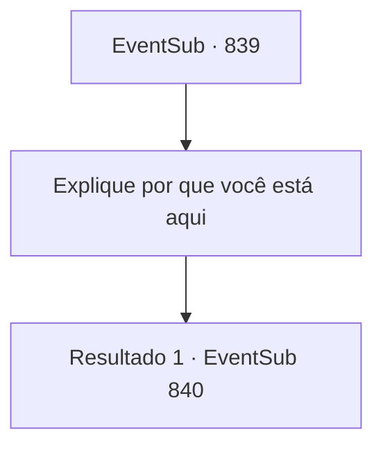

# Eventos secundários · 839

[Índice da tabela](index.md) · [Índice geral](../index.md)

ID: `pt:EventSub:839` · Fonte: `EventSub4` · Versão: 1.2.47.

Mapeamento estático dos arquivos; a disponibilidade e a execução dependem do estado da run.

## Texto do evento

*Sem texto no arquivo.*

## Dados de entrada

```json
{
  "id": 839,
  "grade": 1,
  "subEvent": "",
  "required": ""
}
```

## Mapa das escolhas



## Escolhas e resultados

### Escolha 1

Explique por que você está aqui

Requisitos e outros campos da escolha:

```json
{
  "required": ""
}
```

#### Resultado 1.1

Você conta a Lei sobre o pedido do comerciante. Lei ouve sua história, então começa a coçar o rosto de vergonha. 

 "Oh... Eu- Eu entendo. Meu erro, Sohyeop. Acredito que sou a fonte dos ruídos. Eu estava... treinando. Em segredo."

 Lei limpa a garganta e muda de assunto. 

 "Minhas artes marciais... ainda não estão completas. Ainda não dominei o Ensinamento Supremo. Uma vez que eu aprender isso, não precisarei mais ter medo de perseguidores."

 Ele para de falar por um momento, suspira e acrescenta. 

 "O Chefe do Clã me deu uma demonstração há muito tempo. Uma vez. Eu revirei minhas memórias para praticar a mesma habilidade... Mas, é ainda mais difícil do que eu esperava."

 Lei fica brevemente perdido em pensamentos. Então, ele te faz uma pergunta, cuidadosamente. 

 "Então eu quero perguntar... você pode me ajudar, Sohyeop?"


Continuação registrada: [Evento 840](0840.md) na mesma tabela.

```json
{
  "required": "",
  "chance": "1",
  "nextEvent": 840,
  "type": 2,
  "reward": ""
}
```

## Referências que chegam a este evento

- [Evento 838 · escolha 1 · resultado 1](0838.md#escolha-1)
- [Evento 838 · escolha 2 · resultado 1](0838.md#escolha-2)
