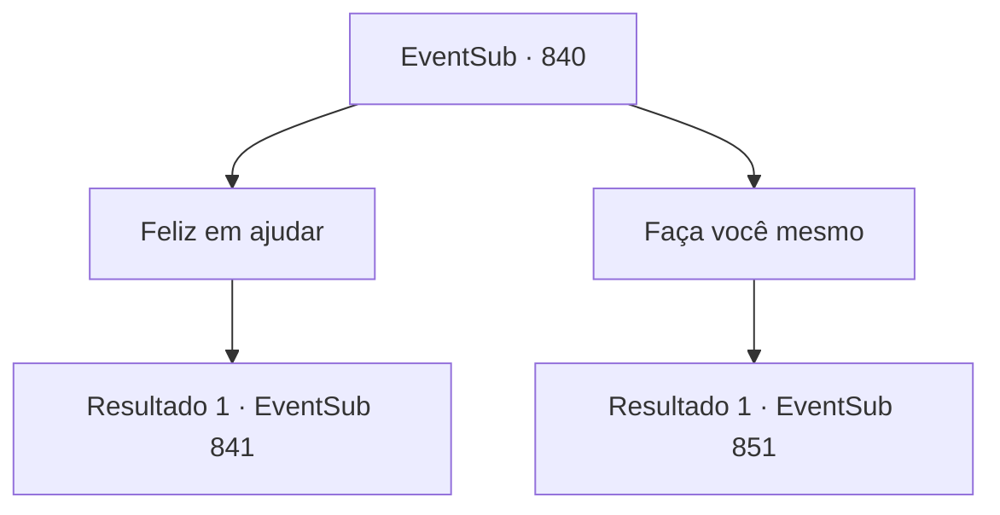

# Eventos secundários · 840

[Índice da tabela](index.md) · [Índice geral](../index.md)

ID: `pt:EventSub:840` · Fonte: `EventSub4` · Versão: 1.2.47.

Mapeamento estático dos arquivos; a disponibilidade e a execução dependem do estado da run.

## Texto do evento

*Sem texto no arquivo.*

## Dados de entrada

```json
{
  "id": 840,
  "grade": 1,
  "subEvent": "",
  "required": ""
}
```

## Mapa das escolhas



## Escolhas e resultados

### Escolha 1

Feliz em ajudar

Requisitos e outros campos da escolha:

```json
{
  "required": ""
}
```

#### Resultado 1.1

Você quebra o silêncio respondendo sim. Lei te agradece várias vezes e levanta sua espada. 

 "Certo então. Por favor, me observe."

 Lei começa a se mover com sua espada, como se estivesse se envolvendo em algum tipo de dança. Utilizando o impulso e a velocidade da espada, o movimento de Lei vai de rápido para lento, depois de lento para rápido novamente. Parece que você está assistindo o fluxo da água. O lado negativo é que esse estado de postura semelhante a um transe só pode durar por um tempo muito curto. 

 "Então... como foi?"


Continuação registrada: [Evento 841](0841.md) na mesma tabela.

```json
{
  "required": "",
  "chance": "1",
  "nextEvent": 841,
  "type": 2,
  "reward": ""
}
```

### Escolha 2

Faça você mesmo

Requisitos e outros campos da escolha:

```json
{
  "required": ""
}
```

#### Resultado 2.1

Você recusa o pedido de Lei, dizendo que aprender um movimento assim deve ser feito sozinho, sem ajuda externa. Lei concorda com um aceno, embora ainda pareça um pouco desapontado. 

 "Você está certo. Eu não deveria ter pedido isso a você em primeiro lugar. Mas se você mudar de ideia, por favor, venha me procurar novamente."

 Você se despede de Lei e retorna à cidade costeira. Você diz ao comerciante da cidade que o barulho não virá mais. Ela fica tão feliz em ouvir isso que lhe oferece uma refeição completa gratuitamente. 

 Alguns dias depois, ouve-se a notícia de uma tempestade se aproximando. Você decide esperar a tempestade passar na taverna local. 

 "Você ouviu? Uma grande briga estourou perto daquela enseada."

 "Ouviu? Eu vi com meus próprios olhos! Um monte de orientais indo um para a garganta do outro!"

 Você está prestes a tomar um gole de sua cerveja quando ouve a notícia perturbadora. Eles devem estar falando sobre o esconderijo de Lei.

Continuação registrada: [Evento 851](0851.md) na mesma tabela.

```json
{
  "required": "",
  "chance": "1",
  "nextEvent": 851,
  "type": 2,
  "reward": "0_0_1"
}
```

## Referências que chegam a este evento

- [Evento 839 · escolha 1 · resultado 1](0839.md#escolha-1)
