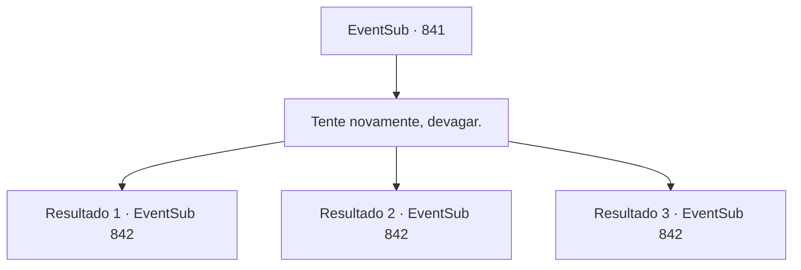

# Eventos secundários · 841

[Índice da tabela](index.md) · [Índice geral](../index.md)

ID: `pt:EventSub:841` · Fonte: `EventSub4` · Versão: 1.2.47.

Mapeamento estático dos arquivos; a disponibilidade e a execução dependem do estado da run.

## Texto do evento

*Sem texto no arquivo.*

## Dados de entrada

```json
{
  "id": 841,
  "grade": 1,
  "subEvent": "",
  "required": ""
}
```

## Mapa das escolhas



## Escolhas e resultados

### Escolha 1

Tente novamente, devagar.

Requisitos e outros campos da escolha:

```json
{
  "required": ""
}
```

#### Resultado 1.1

Lei segue seu conselho, recriando lentamente os movimentos do Ensino Supremo mais uma vez. É um contra-ataque, usado em resposta ao ataque do oponente. O movimento é feito da seguinte forma. Vire a espada diagonalmente no momento certo para escapar do ataque do oponente, vire e avance para fechar a distância, e use o impulso da mudança para desferir o golpe decisivo. Você observa os movimentos de Lei por mais alguns segundos. Você percebe uma estranheza em Lei. Seu corpo está tremendo enquanto ele gira. Focando em cada movimento dele, você o examina cuidadosamente, e logo consegue encontrar o problema. Lei tem o hábito de plantar o pé de apoio enquanto fecha a distância - esse era o problema.

Continuação registrada: [Evento 842](0842.md) na mesma tabela.

```json
{
  "required": "21_51_4",
  "chance": "1|0_7_1",
  "nextEvent": 842,
  "type": 0,
  "reward": ""
}
```

#### Resultado 1.2

Lei segue seu conselho, recriando lentamente os movimentos do Ensinamento Supremo mais uma vez. Você observa os movimentos de Lei por mais alguns segundos. Você percebe a falta de jeito em Lei. Seu corpo está tremendo enquanto ele gira. Mas por mais que você olhe, não consegue identificar o problema.

Continuação registrada: [Evento 842](0842.md) na mesma tabela.

```json
{
  "required": "21_51_4",
  "chance": "20",
  "nextEvent": 842,
  "type": 1,
  "reward": ""
}
```

#### Resultado 1.3

Lei segue seu conselho, recriando lentamente os movimentos do Ensino Supremo mais uma vez. É um contra-ataque, usado em resposta ao ataque do oponente. O movimento é feito da seguinte forma. Vire a espada diagonalmente no momento certo para escapar do ataque do oponente, vire e avance para fechar a distância, e use o impulso da mudança para desferir o golpe decisivo. Você observa os movimentos de Lei por mais alguns segundos. Você percebe uma estranheza em Lei. Seu corpo está tremendo enquanto ele gira. Focando em cada movimento dele, você o examina cuidadosamente, e logo consegue encontrar o problema. Lei tem o hábito de plantar o pé de apoio enquanto fecha a distância - esse era o problema.

Continuação registrada: [Evento 842](0842.md) na mesma tabela.

```json
{
  "required": "20_51_4",
  "chance": "1",
  "nextEvent": 842,
  "type": 2,
  "reward": ""
}
```

## Referências que chegam a este evento

- [Evento 840 · escolha 1 · resultado 1](0840.md#escolha-1)
