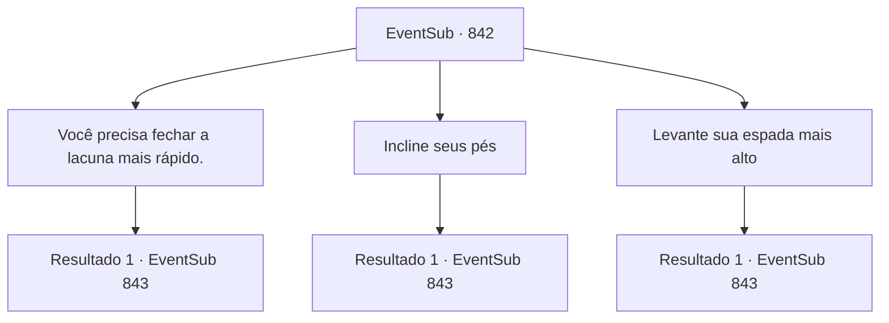

# Eventos secundários · 842

[Índice da tabela](index.md) · [Índice geral](../index.md)

ID: `pt:EventSub:842` · Fonte: `EventSub4` · Versão: 1.2.47.

Mapeamento estático dos arquivos; a disponibilidade e a execução dependem do estado da run.

## Texto do evento

*Sem texto no arquivo.*

## Dados de entrada

```json
{
  "id": 842,
  "grade": 1,
  "subEvent": "",
  "required": ""
}
```

## Mapa das escolhas



## Escolhas e resultados

### Escolha 1

Você precisa fechar a lacuna mais rápido.

Requisitos e outros campos da escolha:

```json
{
  "required": ""
}
```

#### Resultado 1.1

Você aconselha Lei a fechar a distância mais rápido. Seu conselho acaba sendo errado, no entanto. Com sua atenção fixa na velocidade, agora ele não tem espaço suficiente para balançar sua espada. 

 "Hum... Eu não acho que seja isso. Preciso dar mais tempo. Por favor, Sohyeop. Sinta-se à vontade para me instruir mais."

 Os movimentos de Lei estão ficando cada vez melhores, mas parece que ele ainda precisa de mais tempo. Você passa mais alguns dias em seu esconderijo, ajudando em seu treinamento. O tempo voa. 

 Uma noite, você acorda e se vê sozinho no esconderijo. Você procura por Lei, mas ele não está em lugar nenhum. Não há nada além de você, a fogueira e a escuridão.

Continuação registrada: [Evento 843](0843.md) na mesma tabela.

```json
{
  "required": "",
  "chance": "1",
  "nextEvent": 843,
  "type": 2,
  "reward": "5_734_2"
}
```

### Escolha 2

Incline seus pés

Requisitos e outros campos da escolha:

```json
{
  "required": ""
}
```

#### Resultado 2.1

Você aconselha Lei a mudar o ângulo dos pés. Esse único conselho muda tudo. Os movimentos de Lei se tornam muito mais estáveis do que antes. Ele muda sua postura mais algumas vezes, então exclama de alegria. 

 "Girar é muito mais fácil agora, com o ângulo diferente!"

 Lei pula para cima e para baixo no lugar e vem segurar suas mãos. Ele imediatamente limpa a garganta e dá um passo para trás. 

 "A- Ahem.. Eu agradeço pelo seu precioso conselho!"

 Você passa o dia inteiro no esconderijo dele, ajudando em seu treinamento. 

 Uma noite, você acorda e se vê sozinho no esconderijo. Você nem se lembra de como adormeceu na noite passada. Você procura por Lei, mas ele não está em lugar nenhum. Não há nada além de você, a fogueira e a escuridão.

Continuação registrada: [Evento 843](0843.md) na mesma tabela.

```json
{
  "required": "",
  "chance": "1",
  "nextEvent": 843,
  "type": 2,
  "reward": "5_734_1"
}
```

### Escolha 3

Levante sua espada mais alto

Requisitos e outros campos da escolha:

```json
{
  "required": ""
}
```

#### Resultado 3.1

Você aconselha Lei a levantar sua espada mais alto. Seu conselho acaba sendo errado, no entanto. Com a espada levantada mais alto, torna-se muito mais difícil para ele se equilibrar. 

 "Hum... Eu não acho que seja isso. Preciso dar mais tempo. Por favor, Sohyeop. Sinta-se à vontade para me instruir mais."

 Os movimentos de Lei estão ficando cada vez melhores, mas parece que ele ainda precisa de mais tempo. Você passa mais alguns dias em seu esconderijo, ajudando em seu treinamento. O tempo voa. 

 Uma noite, você acorda e se vê sozinho no esconderijo. Você nem se lembra de como adormeceu na noite passada. Você procura por Lei, mas ele não está em lugar nenhum. Não há nada além de você, a fogueira e a escuridão.

Continuação registrada: [Evento 843](0843.md) na mesma tabela.

```json
{
  "required": "",
  "chance": "1",
  "nextEvent": 843,
  "type": 2,
  "reward": "5_734_2"
}
```

## Referências que chegam a este evento

- [Evento 841 · escolha 1 · resultado 1](0841.md#escolha-1)
- [Evento 841 · escolha 1 · resultado 2](0841.md#escolha-1)
- [Evento 841 · escolha 1 · resultado 3](0841.md#escolha-1)
