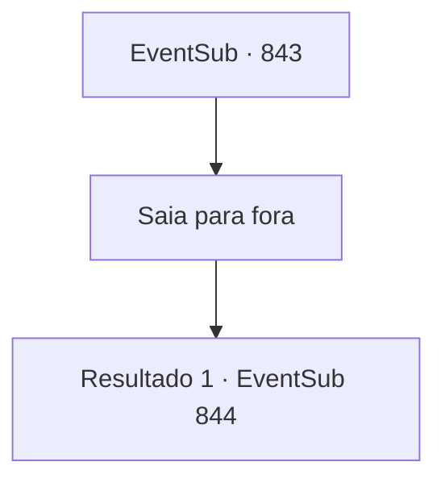

# Eventos secundários · 843

[Índice da tabela](index.md) · [Índice geral](../index.md)

ID: `pt:EventSub:843` · Fonte: `EventSub4` · Versão: 1.2.47.

Mapeamento estático dos arquivos; a disponibilidade e a execução dependem do estado da run.

## Texto do evento

*Sem texto no arquivo.*

## Dados de entrada

```json
{
  "id": 843,
  "grade": 1,
  "subEvent": "",
  "required": ""
}
```

## Mapa das escolhas



## Escolhas e resultados

### Escolha 1

Saia para fora

Requisitos e outros campos da escolha:

```json
{
  "required": ""
}
```

#### Resultado 1.1

Você sai da caverna para procurar Lei. Felizmente, você encontra um rastro fraco de pegadas. Você não tem ideia de onde ele leva, mas o segue mesmo assim. O rastro leva você a um pequeno rio, não muito longe da enseada. |drawing_FemaleLei| Lá está Lei, depois de desaparecer no meio da noite. Só que... você não tem tanta certeza se é realmente a Lei que você conhece. A pessoa que está ali não é um homem, mas uma 'mulher'. 

 "AAAAH! S- SOHYEOP...?!"

 Ela te avista enquanto seca o cabelo na margem do rio, soltando um grito agudo.

Continuação registrada: [Evento 844](0844.md) na mesma tabela.

```json
{
  "required": "",
  "chance": "1",
  "nextEvent": 844,
  "type": 2,
  "reward": ""
}
```

## Referências que chegam a este evento

- [Evento 842 · escolha 1 · resultado 1](0842.md#escolha-1)
- [Evento 842 · escolha 2 · resultado 1](0842.md#escolha-2)
- [Evento 842 · escolha 3 · resultado 1](0842.md#escolha-3)
