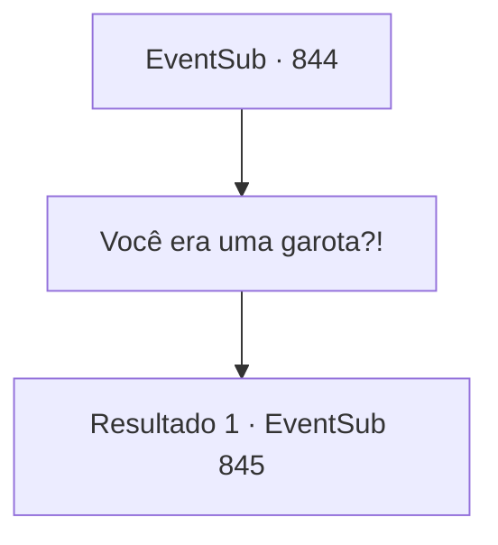

# Eventos secundários · 844

[Índice da tabela](index.md) · [Índice geral](../index.md)

ID: `pt:EventSub:844` · Fonte: `EventSub4` · Versão: 1.2.47.

Mapeamento estático dos arquivos; a disponibilidade e a execução dependem do estado da run.

## Texto do evento

*Sem texto no arquivo.*

## Dados de entrada

```json
{
  "id": 844,
  "grade": 1,
  "subEvent": "",
  "required": ""
}
```

## Mapa das escolhas



## Escolhas e resultados

### Escolha 1

Você era uma garota?!

Requisitos e outros campos da escolha:

```json
{
  "required": ""
}
```

#### Resultado 1.1

Lei responde com um longo suspiro. 

 "Eu não quis enganar você. Eu sempre me vestia como um homem antes de sair, mesmo no Oriente. As circunstâncias em que me encontro ditam que eu esconda minha identidade. Além disso, viajar sozinha é uma opção muito melhor..."

 Lei organiza seu cabelo e ajeita suas roupas. Ela abaixa a voz, falando como um homem novamente. 

 "Portanto, peço que continue a me tratar como um homem, como tem feito até agora, Sohyeop."


Continuação registrada: [Evento 845](0845.md) na mesma tabela.

```json
{
  "required": "",
  "chance": "1",
  "nextEvent": 845,
  "type": 2,
  "reward": ""
}
```

## Referências que chegam a este evento

- [Evento 843 · escolha 1 · resultado 1](0843.md#escolha-1)
