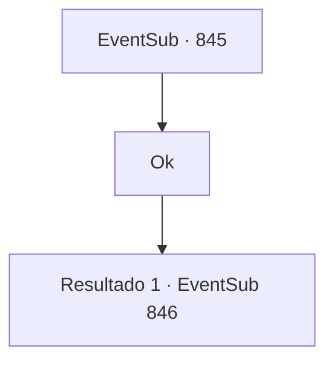

# Eventos secundários · 845

[Índice da tabela](index.md) · [Índice geral](../index.md)

ID: `pt:EventSub:845` · Fonte: `EventSub4` · Versão: 1.2.47.

Mapeamento estático dos arquivos; a disponibilidade e a execução dependem do estado da run.

## Texto do evento

*Sem texto no arquivo.*

## Dados de entrada

```json
{
  "id": 845,
  "grade": 1,
  "subEvent": "",
  "required": ""
}
```

## Mapa das escolhas



## Escolhas e resultados

### Escolha 1

Ok

Requisitos e outros campos da escolha:

```json
{
  "required": ""
}
```

#### Resultado 1.1

Você acena com a cabeça, concordando em manter o segredo de Lei. Vocês dois retornam ao esconderijo e adormecem. 

 "...Sohyeop! SOHYEOP! Acorde!"

 A manhã chega, e a voz desesperada de Lei te desperta. Lei já está com sua arma nas mãos, olhando para fora da caverna. Você rapidamente se levanta e imediatamente percebe por que ela parecia tão desesperada. O esconderijo está cercado por um grupo de homens armados. |drawing_Shao| 

 "Que lugar aconchegante você tem, Lei. Combina bem com você. Mas tudo termina hoje."

 É o mesmo grupo de guerreiros orientais que atacou vocês da última vez. Shao emerge entre eles e fala. 

 "Dracos Vermelhos! MATEM-NOS!"

 Obedecendo à sua ordem, os guerreiros orientais formam um círculo ao redor de você e Lei.

Continuação registrada: [Evento 846](0846.md) na mesma tabela.

```json
{
  "required": "",
  "chance": "1",
  "nextEvent": 846,
  "type": 2,
  "reward": "6_3_179",
  "place": 8
}
```

## Referências que chegam a este evento

- [Evento 844 · escolha 1 · resultado 1](0844.md#escolha-1)
