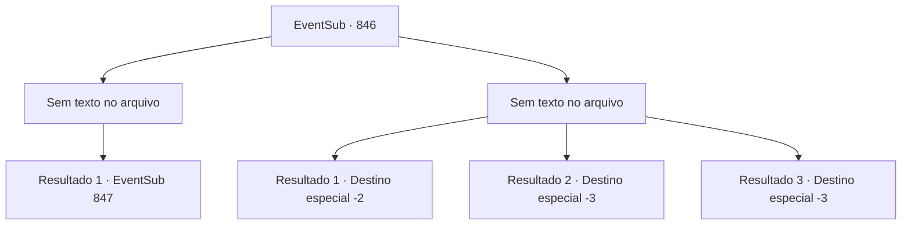

# Eventos secundários · 846

[Índice da tabela](index.md) · [Índice geral](../index.md)

ID: `pt:EventSub:846` · Fonte: `EventSub4` · Versão: 1.2.47.

Mapeamento estático dos arquivos; a disponibilidade e a execução dependem do estado da run.

## Texto do evento

*Sem texto no arquivo.*

## Dados de entrada

```json
{
  "id": 846,
  "grade": 1,
  "subEvent": "",
  "required": ""
}
```

## Mapa das escolhas



## Escolhas e resultados

### Escolha 1

*Sem texto no arquivo; o papel dessa opção depende da interface do jogo.*

Requisitos e outros campos da escolha:

```json
{
  "required": ""
}
```

#### Resultado 1.1

Eles são habilidosos em combate, mas não tão fortes quanto você e Lei. Você e Lei conseguem derrotar todos os Drakes Vermelhos. Você volta seu olhar para Shao, que está olhando maliciosamente para Lei. 

 "Hmph. Pelo menos você é melhor do que aquela sua mãe plebeia. Tudo o que ela podia fazer era rir."

 Lei, em vez de enlouquecer com a provocação de Shao, aponta sua espada para ela em resposta. Shao aceita o desafio de Lei sacando sua própria espada, com uma condição. 

 "Tudo bem. Vou lutar com você eu mesma. Você quer dois contra um? Estou bem de qualquer maneira. É sempre bom derrotar dois covardes, que não têm confiança nenhuma em si mesmos."

 Lei fica em silêncio por um tempo, então olha para você. 

 "...Eu tenho um pedido, Sohyeop. Esta luta é minha, e eu desejo fazê-la sozinho."

 Você olha silenciosamente para Lei. Seu ombro direito está coberto de vermelho. Parece que ele se feriu na batalha anterior.

Continuação registrada: [Evento 847](0847.md) na mesma tabela.

```json
{
  "required": "",
  "chance": "1",
  "nextEvent": 847,
  "type": 2,
  "reward": ""
}
```

### Escolha 2

*Sem texto no arquivo; o papel dessa opção depende da interface do jogo.*

Requisitos e outros campos da escolha:

```json
{
  "required": ""
}
```

#### Resultado 2.1

Você recupera o fôlego e olha ao redor. Há boas e más notícias. A boa notícia é que, apesar de ter perdido a luta, você conseguiu romper a linha de defesa e escapar. A má notícia é que você não faz ideia de para onde Lei foi.  

 'GRRRRRR. *RUMBLE*' 

 Uma tempestade trovejante começa. Você não precisa mais se preocupar com perseguidores, mas agora deve encontrar abrigo da força da natureza. Você olha para trás na direção do esconderijo e anda mais rápido.

Continuação registrada: [Destino especial `-2`](../destinos-especiais.md).

```json
{
  "required": "1_0_2|1_1_2",
  "chance": "1",
  "nextEvent": -2,
  "type": 2,
  "reward": "0_0_-1|0_1_-1|12_11_-1"
}
```

#### Resultado 2.2

Você instintivamente percebe que está prestes a ser derrotado. Você tenta fugir, mas os Dracos Vermelhos já o encurralaram. 

 "...SOHYEOP, NÃO!!"

 Nesse momento, você ouve Lei gritando. Uma dor lancinante atinge você, como se tivesse tocado algo escaldante. Sangue jorra das suas costas. Seu corpo se sente impotente. Parece que você foi atacado por trás. Você tenta ao máximo se levantar, mas não consegue. Infelizmente, você cai e encontra seu fim.

Continuação registrada: [Destino especial `-3`](../destinos-especiais.md).

```json
{
  "required": "2_0_2",
  "chance": "1",
  "nextEvent": -3,
  "type": 2,
  "reward": "0_0_-1|0_1_-1"
}
```

#### Resultado 2.3

Você instintivamente percebe que está prestes a ser derrotado. Você tenta fugir, mas os Dracos Vermelhos já o encurralaram. 

 "...SOHYEOP, NÃO!!"

 Nesse momento, você ouve Lei gritando. Uma dor lancinante atinge você, como se tivesse tocado algo escaldante. Sangue jorra das suas costas. Seu corpo se sente impotente. Parece que você foi atacado por trás. Você tenta ao máximo se levantar, mas não consegue. Infelizmente, você cai e encontra seu fim.

Continuação registrada: [Destino especial `-3`](../destinos-especiais.md).

```json
{
  "required": "2_1_2",
  "chance": "1",
  "nextEvent": -3,
  "type": 2,
  "reward": "0_0_-1|0_1_-1"
}
```

## Referências que chegam a este evento

- [Evento 845 · escolha 1 · resultado 1](0845.md#escolha-1)
- [Evento 852 · escolha 1 · resultado 1](0852.md#escolha-1)
