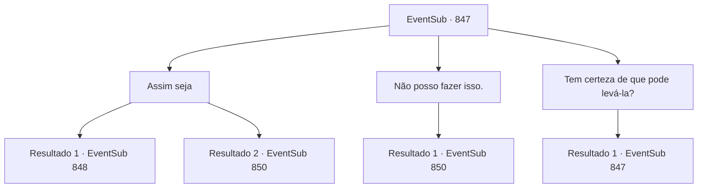

# Eventos secundários · 847

[Índice da tabela](index.md) · [Índice geral](../index.md)

ID: `pt:EventSub:847` · Fonte: `EventSub4` · Versão: 1.2.47.

Mapeamento estático dos arquivos; a disponibilidade e a execução dependem do estado da run.

## Texto do evento

*Sem texto no arquivo.*

## Dados de entrada

```json
{
  "id": 847,
  "grade": 1,
  "subEvent": "",
  "required": ""
}
```

## Mapa das escolhas



## Escolhas e resultados

### Escolha 1

Assim seja

Requisitos e outros campos da escolha:

```json
{
  "required": ""
}
```

#### Resultado 1.1

Você recua, deixando Lei lutar. Lei se curva em gratidão e caminha até Shao. 

 A batalha começa. É um espetáculo e tanto de se assistir, e também extraordinariamente perigoso. Lâminas prateadas nas gargantas uma da outra, as duas duelistas preenchem o ambiente com o som do aço se chocando. 
 <link=shake>'SCHWING-! KA-CHING! KGGGGGK-!! KNNG--!'</link> 
 A feroz batalha termina com Lei como a vencedora. Ela segura sua espada na diagonal, desvia o ataque de Shao, gira e desferre um golpe poderoso. O Ensinamento Supremo, como o golpe final. Shao deixa cair sua espada e se ajoelha. Ela está à mercê de Lei, com a espada de Lei bem na sua garganta. Mas ela hesita em dar o golpe final. 

 "...Sempre soube que você me odiava, Shao. Mas... ir uma contra a outra assim?! Por quê? Por que você está tentando me matar?"

 Shao não responde a essa pergunta. 

 "Heh. Pare de fingir ser inocente, verme. Ridículo, agindo como se fosse algum tipo de santa... Apenas me mate logo."


Continuação registrada: [Evento 848](0848.md) na mesma tabela.

```json
{
  "required": "5_734_1",
  "chance": "1",
  "nextEvent": 848,
  "type": 2,
  "reward": ""
}
```

#### Resultado 1.2

Você recua, deixando Lei lutar. Lei se curva em gratidão e caminha até Shao. 

 A batalha começa. É um verdadeiro espetáculo de se ver, e também extremamente perigoso. Lâminas prateadas nas gargantas uma da outra, os dois duelistas preenchem o ambiente com o som do aço se chocando. 
 <link=shake>'KEEEEEEE-!! GRRRGT--! *THUD*!!'</link> 
 A feroz batalha termina com Shao como vencedor. Lei tenta finalizar o duelo com o movimento do Ensinamento Supremo, mas a falta de domínio e conclusão falha em competir contra os golpes de Shao. A espada de Lei é arremessada de suas mãos. Aproveitando a chance, Shao dá um chute poderoso bem no peito de Lei. Lei é lançado para longe. Seu corpo atinge uma árvore próxima, depois fica imóvel no chão. 

 "*ofegante*...*ofegante*... Agora é sua vez!"

 Shao volta seu olhar para você, ofegante. A segunda batalha começa imediatamente.

Continuação registrada: [Evento 850](0850.md) na mesma tabela.

```json
{
  "required": "5_734_2",
  "chance": "1",
  "nextEvent": 850,
  "type": 2,
  "reward": "6_0_178",
  "place": 8
}
```

### Escolha 2

Não posso fazer isso.

Requisitos e outros campos da escolha:

```json
{
  "required": ""
}
```

#### Resultado 2.1

Você rejeita o pedido de Lei, dizendo que não vai deixá-lo fazer isso. Lei suspira, então acena com a cabeça. Shao continua a provocar vocês dois, apesar das probabilidades contra ela. 

 "Hmph. Não importa. Vocês dois morrerão pelas minhas mãos."

 Shao fez o primeiro ataque. Com um salto forte, ela rapidamente fecha a distância e lança sua espada na garganta de Lei. Lei desvia, desequilibrando Shao. Você aproveita a oportunidade e ataca Shao.

Continuação registrada: [Evento 850](0850.md) na mesma tabela.

```json
{
  "required": "",
  "chance": "1",
  "nextEvent": 850,
  "type": 2,
  "reward": "6_2_178",
  "place": 8
}
```

### Escolha 3

Tem certeza de que pode levá-la?

Requisitos e outros campos da escolha:

```json
{
  "required": "5_735_0"
}
```

#### Resultado 3.1

Você pergunta a Lei se ele acha que ela pode derrotar Shao. Ele responde com um pequeno sorriso. 

 "Só há uma maneira de descobrir. Mas... se eu der tudo de mim, pelo menos não vou me arrepender de nada."


Continuação registrada: [Evento 847](0847.md) na mesma tabela.

```json
{
  "required": "",
  "chance": "1",
  "nextEvent": 847,
  "type": 2,
  "reward": "5_735_1"
}
```

## Referências que chegam a este evento

- [Evento 846 · escolha 1 · resultado 1](0846.md#escolha-1)
- [Evento 847 · escolha 3 · resultado 1](0847.md#escolha-3)
