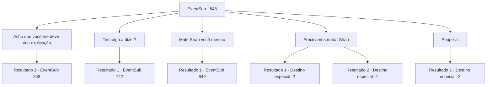

# Eventos secundários · 848

[Índice da tabela](index.md) · [Índice geral](../index.md)

ID: `pt:EventSub:848` · Fonte: `EventSub4` · Versão: 1.2.47.

Mapeamento estático dos arquivos; a disponibilidade e a execução dependem do estado da run.

## Texto do evento

*Sem texto no arquivo.*

## Dados de entrada

```json
{
  "id": 848,
  "grade": 1,
  "subEvent": "",
  "required": ""
}
```

## Mapa das escolhas



## Escolhas e resultados

### Escolha 1

Acho que você me deve uma explicação.

Requisitos e outros campos da escolha:

```json
{
  "required": "5_727_0"
}
```

#### Resultado 1.1

Você pergunta a Lei por uma explicação. Lei hesita por um momento antes de falar novamente. 

 "suspiro... Meu pai é o Chefe do Clã Ryu. Mas minha mãe era uma prostituta. O clã nem sequer a reconhecia como uma concubina."

 Ou seja, Shao e Lei eram meias-irmãs. Lei sorri amargamente. 

 "Meu pai me aceitou como uma filha legítima, cuidou de mim e me amou, apesar do meu status social. Ele nunca me forçou a treinar com uma espada, mas fiz o meu melhor para retribuir sua bondade. Felizmente, eu tinha um talento humilde. Consegui desenvolver habilidades que poderiam ser úteis para o meu pai e para o clã."

 Lei olha silenciosamente para suas mãos, cobertas de calos. 

 "Mas nem todos gostavam de mim. Especialmente Shao. Ela me odiava, mesmo na infância. Depois que nosso Chefe do Clã ficou acamado, o desprezo de Shao e de seu povo por mim ficou cada vez mais evidente. É por isso que quero provar meu valor. Ganhar a aprovação dos membros do clã."

 Quando Lei termina de falar, Shao solta uma risada óbvia de desprezo. 

 "Ha. Ridículo."


Continuação registrada: [Evento 848](0848.md) na mesma tabela.

```json
{
  "required": "",
  "chance": "1",
  "nextEvent": 848,
  "type": 2,
  "reward": "5_727_1"
}
```

### Escolha 2

Tem algo a dizer?

Requisitos e outros campos da escolha:

```json
{
  "required": "5_727_1"
}
```

#### Resultado 2.1

Você deixa Shao falar.   

 "...Tudo bem, eu vou te contar. Lei sempre foi um incômodo.   Todo dia, aquela pirralha sentava no colo do Chefe do Clã e ria enquanto ele a alimentava com iguarias! E o que eu ganhava? Eu treinava e treinava e treinava, só para ele olhar para mim uma vez! Eu sempre me perguntava quando eu veria ele sorrir para mim. Quando - se - ele me daria um tapinha na cabeça e me alimentaria com petiscos."

   Segundo ela, seu pai favorecia muito Lei. Muito.   Mas Shao diz que há mais na história.   

 "Eu me odeio por admitir isso, mas Lei era de fato melhor com espadas do que eu. Ha! Uma plebeia, com tais habilidades... Acontece que é o sangue do Chefe do Clã naquela criança, afinal.   Então, uma crise veio ao nosso clã. Algumas pessoas começaram a afirmar que Lei deveria se tornar a Chefe do Clã, em vez de mim, dizendo que a posição de herdeiro deveria ir para quem tivesse a maior destreza.   E então aquele idiota imediatamente anuncia que vai competir no Torneio Battra, para 'provar a si mesmo'!"

   Shao acrescenta, olhando maliciosamente para Lei.   

 "Obviamente, isso é um plano para tomar a posição de Chefe do Clã! E ainda assim Lei age como se fosse a vítima aqui, fingindo ser inocente!"

   Depois de ouvir o monólogo de Shao, Lei explode em uma risada sem emoção.   

 "Ha... Haha..."


Continuação registrada: [Evento 742](0742.md) na mesma tabela.

```json
{
  "required": "",
  "chance": "1",
  "nextEvent": 742,
  "type": 2,
  "reward": "5_727_2"
}
```

### Escolha 3

Mate Shao você mesmo

Requisitos e outros campos da escolha:

```json
{
  "required": "2_3_0"
}
```

#### Resultado 3.1

Você se cansa de esperar, então empurra Lei para trás e mata Shao com suas próprias mãos. Lei fica assustada, mas é tarde demais para te parar. 

 "Ack...! *gorgolejo*"

 Sangue espirra por todo o lago enquanto o corpo sem vida de Shao desmorona. Observando você em terror, Lei corre até você e grita. 

 "...SOHYEOP! Por que você faria isso?! Mesmo que ela merecesse morrer, eu deveria ter sido a pessoa a acabar com ela!"


Continuação registrada: [Evento 849](0849.md) na mesma tabela.

```json
{
  "required": "",
  "chance": "1",
  "nextEvent": 849,
  "type": 2,
  "reward": ""
}
```

### Escolha 4

Precisamos matar Shao

Requisitos e outros campos da escolha:

```json
{
  "required": ""
}
```

#### Resultado 4.1

Você aconselha Lei que esta é sua chance de acabar com tudo. Com um senso de determinação, Lei balança sua espada. 

 "Ack...! *gorgolejo*"

 Sangue espirra por todo o lago enquanto o corpo sem vida de Shao desmorona. Mesmo após a morte, os olhos de Shao estão fixos em Lei. Lei olha fixamente para seu trabalho sombrio antes de se afastar. De alguma forma, mesmo com sua vingança completa, Lei não parece nada feliz. Lei lança um último olhar para o cadáver de Shao antes de partir com uma expressão triste.

Continuação registrada: [Destino especial `-2`](../destinos-especiais.md).

```json
{
  "required": "",
  "chance": "1|0_12_1",
  "nextEvent": -2,
  "type": 0,
  "reward": "12_11_7"
}
```

#### Resultado 4.2

Você sugere que Lei acabe com Shao. Mas a expressão de Lei grita hesitação. No entanto, ele embainha sua espada. Shao explode em risadas e começa a provocá-lo. 

 "HA! Fingindo ser o bonzinho até o fim... FAÇA ISSO! ME MATE! Você nem tem CORAGEM! Você é tão fraco quanto sua mãe! Mais adequado para bajular homens e..."

 Shao não consegue terminar. Lei dá um soco, acertando Shao no rosto. Shao é imediatamente nocauteado. Os Dragões Vermelhos a ajudam ansiosamente a se levantar. Ignorando seus movimentos, Lei se curva para você e se despede. 

 "Agradeço por tudo até agora, Sohyeop. Adeus..."


Continuação registrada: [Destino especial `-2`](../destinos-especiais.md).

```json
{
  "required": "",
  "chance": "20",
  "nextEvent": -2,
  "type": 1,
  "reward": "12_11_4"
}
```

### Escolha 5

Poupe-a.

Requisitos e outros campos da escolha:

```json
{
  "required": ""
}
```

#### Resultado 5.1

Lei te ouve, solta um longo suspiro e embainha sua espada. Ele decidiu não matar Shao. Shao franze a testa em resposta, gritando. 

 "Você espera que eu peça desculpas ou algo assim? Não se arrependa depois e termine o trabalho!"

 Shao quase soa desesperado agora. Mas Lei se recusa a puxar sua espada. Em vez disso, ela olha calmamente para Shao e transmite seus pensamentos. 

 "A grandeza começa pela misericórdia. Nosso lema do clã. Estou simplesmente honrando-o."

 Shao grita para ela parar com as bobagens, mas Lei se afasta, ignorando-a. 

 "Se você ainda guarda rancor contra mim, vamos resolver isso no Torneio Battra. Estarei lá, sem dúvida. Estou cansado de fugir."

 Você e Lei deixam Shao lá e se afastam da área. Lei não esquece de te agradecer. 

 "Mil agradecimentos, Sohyeop. As palavras do meu pai... Elas vieram à minha mente, depois de ouvir o que você me disse. Estou indo para Gladio agora. Se você também planeja competir no torneio, nos veremos mais uma vez."

 Lei te agradece uma última vez antes de se despedir e se afastar animadamente.

Continuação registrada: [Destino especial `-2`](../destinos-especiais.md).

```json
{
  "required": "",
  "chance": "1",
  "nextEvent": -2,
  "type": 2,
  "reward": "12_11_4"
}
```

## Referências que chegam a este evento

- [Evento 847 · escolha 1 · resultado 1](0847.md#escolha-1)
- [Evento 848 · escolha 1 · resultado 1](0848.md#escolha-1)
- [Evento 850 · escolha 1 · resultado 1](0850.md#escolha-1)
- [Evento 850 · escolha 2 · resultado 1](0850.md#escolha-2)
