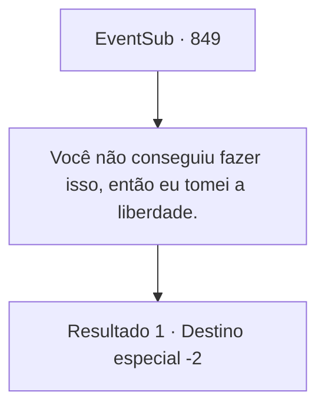

# Eventos secundários · 849

[Índice da tabela](index.md) · [Índice geral](../index.md)

ID: `pt:EventSub:849` · Fonte: `EventSub4` · Versão: 1.2.47.

Mapeamento estático dos arquivos; a disponibilidade e a execução dependem do estado da run.

## Texto do evento

*Sem texto no arquivo.*

## Dados de entrada

```json
{
  "id": 849,
  "grade": 1,
  "subEvent": "",
  "required": ""
}
```

## Mapa das escolhas



## Escolhas e resultados

### Escolha 1

Você não conseguiu fazer isso, então eu tomei a liberdade.

Requisitos e outros campos da escolha:

```json
{
  "required": ""
}
```

#### Resultado 1.1

Você responde dizendo que só fez o que fez porque Lei não podia. Lei, incapaz de retrucar, simplesmente olha para baixo. 

 "E- Eu..."

 Lei olha para o cadáver de Shao uma última vez antes de partir com uma expressão triste.

Continuação registrada: [Destino especial `-2`](../destinos-especiais.md).

```json
{
  "required": "",
  "chance": "1",
  "nextEvent": -2,
  "type": 2,
  "reward": "12_11_7"
}
```

## Referências que chegam a este evento

- [Evento 848 · escolha 3 · resultado 1](0848.md#escolha-3)
