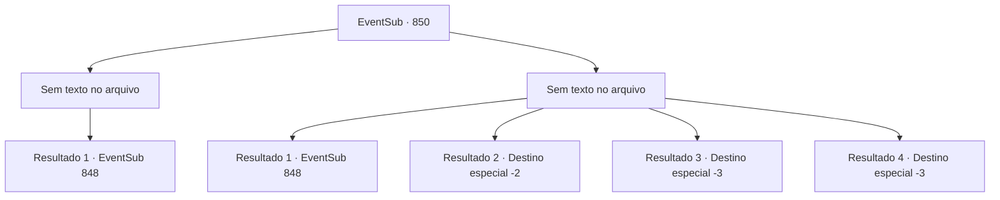

# Eventos secundários · 850

[Índice da tabela](index.md) · [Índice geral](../index.md)

ID: `pt:EventSub:850` · Fonte: `EventSub4` · Versão: 1.2.47.

Mapeamento estático dos arquivos; a disponibilidade e a execução dependem do estado da run.

## Texto do evento

*Sem texto no arquivo.*

## Dados de entrada

```json
{
  "id": 850,
  "grade": 1,
  "subEvent": "",
  "required": ""
}
```

## Mapa das escolhas



## Escolhas e resultados

### Escolha 1

*Sem texto no arquivo; o papel dessa opção depende da interface do jogo.*

Requisitos e outros campos da escolha:

```json
{
  "required": ""
}
```

#### Resultado 1.1

A espada de Shao é lançada no ar, longe de seu alcance. Você se aproxima lentamente dela, que está ajoelhada no chão. Seus olhos, desprovidos de expressão, encaram sua alma. 

 "...Faça isso."

 Você a encara por mais alguns segundos antes de se preparar para acabar com ela. Então, uma voz desesperada chama você. 

 "...E- ESPERE! SOHYEOP! Por favor - um momento!"

 Lei pede educadamente, desviando sua atenção para Shao. 

 "...Eu sempre soube que você me odiava, Shao. Mas... chegar a esse ponto de querer se matar?! Por quê? Por que você está tentando me matar?"

 Shao se recusa a responder sua pergunta. 

 "Heh. Pare de fingir ser inocente, verme. Ridículo, agindo como se fosse algum tipo de santo... Apenas me mate logo."


Continuação registrada: [Evento 848](0848.md) na mesma tabela.

```json
{
  "required": "",
  "chance": "1",
  "nextEvent": 848,
  "type": 2,
  "reward": ""
}
```

### Escolha 2

*Sem texto no arquivo; o papel dessa opção depende da interface do jogo.*

Requisitos e outros campos da escolha:

```json
{
  "required": ""
}
```

#### Resultado 2.1

A espada de Shao voa em sua garganta como uma faísca. Lei intervém com um timing perfeito, bloqueando o ataque. Então, usando o movimento do Ensinamento Supremo que ele aperfeiçoou, afasta a arma de Shao de sua mão. Desarmada, Shao olha para Lei com desgosto. 

 "...Faça isso."

 Mas Lei não balança sua espada. Em vez disso, ele começa a questionar Shao, calmamente. 

 "...Sempre soube que você me odiava, Shao. Mas... ir atrás da garganta um do outro assim?! Por quê? Por que você está tentando me matar?"

 Shao se recusa a responder sua pergunta. 

 "Heh. Pare de fingir ser inocente, verme. Ridículo, agindo como se fosse algum tipo de santo... Apenas me mate logo."


Continuação registrada: [Evento 848](0848.md) na mesma tabela.

```json
{
  "required": "1_0_2|1_1_2|5_734_1",
  "chance": "1",
  "nextEvent": 848,
  "type": 2,
  "reward": ""
}
```

#### Resultado 2.2

Um segundo de descuido trouxe para você um resultado irreversível. Aço afiado se planta em seu peito. Sua carne se abre com sangue. Seu mundo começa a escurecer enquanto sua consciência se esvai. 

 Você mal consegue acordar novamente. Você sente o ar sair dos seus pulmões, mas pelo menos se sente vivo. A ferida em seu peito só recentemente cicatrizou - uma crosta de aparência fresca pode ser vista. Seu corpo ainda está muito quente, e sua cabeça está tonta. Você olha ao redor, mas não encontra nem Lei nem Shao. A única coisa que resta é um rastro frio de sangue seco.

Continuação registrada: [Destino especial `-2`](../destinos-especiais.md).

```json
{
  "required": "1_0_2|1_1_2|5_734_2",
  "chance": "1",
  "nextEvent": -2,
  "type": 2,
  "reward": "0_0_-1|0_1_-1|12_11_-1"
}
```

#### Resultado 2.3

Um segundo de descuido trouxe para você um resultado irreversível. Aço afiado se crava em seu pescoço, separando a cabeça do corpo. Seu mundo começa a escurecer enquanto você encontra seu fim.

Continuação registrada: [Destino especial `-3`](../destinos-especiais.md).

```json
{
  "required": "2_0_2",
  "chance": "1",
  "nextEvent": -3,
  "type": 2,
  "reward": "0_0_-1|0_1_-1"
}
```

#### Resultado 2.4

Um segundo de descuido trouxe para você um resultado irreversível. Aço afiado se crava em seu pescoço, separando a cabeça do corpo. Seu mundo começa a escurecer enquanto você encontra seu fim.

Continuação registrada: [Destino especial `-3`](../destinos-especiais.md).

```json
{
  "required": "2_1_2",
  "chance": "1",
  "nextEvent": -3,
  "type": 2,
  "reward": "0_0_-1|0_1_-1"
}
```

## Referências que chegam a este evento

- [Evento 847 · escolha 1 · resultado 2](0847.md#escolha-1)
- [Evento 847 · escolha 2 · resultado 1](0847.md#escolha-2)
