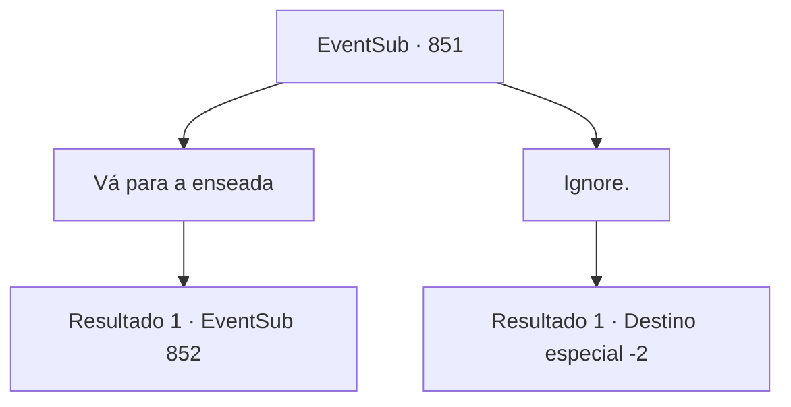

# Eventos secundários · 851

[Índice da tabela](index.md) · [Índice geral](../index.md)

ID: `pt:EventSub:851` · Fonte: `EventSub4` · Versão: 1.2.47.

Mapeamento estático dos arquivos; a disponibilidade e a execução dependem do estado da run.

## Texto do evento

*Sem texto no arquivo.*

## Dados de entrada

```json
{
  "id": 851,
  "grade": 1,
  "subEvent": "",
  "required": ""
}
```

## Mapa das escolhas



## Escolhas e resultados

### Escolha 1

Vá para a enseada

Requisitos e outros campos da escolha:

```json
{
  "required": ""
}
```

#### Resultado 1.1

Você coloca a cerveja na mesa e vai direto para a enseada. Quando você chega, o céu escurece enquanto uma forte chuva começa a cair. Mas nem o som das gotas pesadas de chuva poderia silenciar os gritos agudos e o choque de aço. Você se esconde atrás de uma grande rocha, tentando descobrir o que está acontecendo no esconderijo de Lei. O que você ouviu na taverna é verdade - há uma batalha feroz acontecendo, bem na entrada da caverna. Um grupo de espadachins orientais cercou o local, forçando Lei a se defender e defender. |drawing_Shao| Há uma mulher observando a cena em silêncio, separada do grupo. Ela está apenas... assistindo à luta acontecer, aparentemente sem intenção de ajudar Lei ou intervir. Você aproveita para escutar e percebe que essa mulher é Shao Ryu.

Continuação registrada: [Evento 852](0852.md) na mesma tabela.

```json
{
  "required": "",
  "chance": "1",
  "nextEvent": 852,
  "type": 2,
  "reward": ""
}
```

### Escolha 2

Ignore.

Requisitos e outros campos da escolha:

```json
{
  "required": ""
}
```

#### Resultado 2.1

Você dá de ombros para a sensação ominosa e volta a beber. Logo, você se sente tonto. Suas preocupações e cansaço desaparecem.

Continuação registrada: [Destino especial `-2`](../destinos-especiais.md).

```json
{
  "required": "",
  "chance": "1",
  "nextEvent": -2,
  "type": 2,
  "reward": "12_11_-1|0_1_1"
}
```

## Referências que chegam a este evento

- [Evento 840 · escolha 2 · resultado 1](0840.md#escolha-2)
