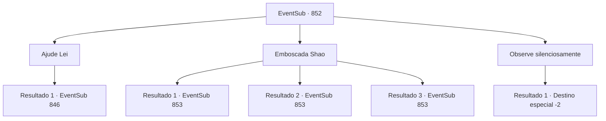

# Eventos secundários · 852

[Índice da tabela](index.md) · [Índice geral](../index.md)

ID: `pt:EventSub:852` · Fonte: `EventSub4` · Versão: 1.2.47.

Mapeamento estático dos arquivos; a disponibilidade e a execução dependem do estado da run.

## Texto do evento

*Sem texto no arquivo.*

## Dados de entrada

```json
{
  "id": 852,
  "grade": 1,
  "subEvent": "",
  "required": ""
}
```

## Mapa das escolhas



## Escolhas e resultados

### Escolha 1

Ajude Lei

Requisitos e outros campos da escolha:

```json
{
  "required": ""
}
```

#### Resultado 1.1

Você entra na luta, atacando os Dracos Vermelhos. Eles ficam surpresos ao ver um novo desafiante. Por um momento, sua formação vacila, pondo fim à sua constante e interminável rajada de ataques. 

 "...SOHYEOP!!"

 Lei aproveita a chance e passa para o ataque. Você e Lei, através de um trabalho em equipe ideal, enfrentam os perseguidores.

Continuação registrada: [Evento 846](0846.md) na mesma tabela.

```json
{
  "required": "",
  "chance": "1",
  "nextEvent": 846,
  "type": 2,
  "reward": "6_3_179",
  "place": 8
}
```

### Escolha 2

Emboscada Shao

Requisitos e outros campos da escolha:

```json
{
  "required": ""
}
```

#### Resultado 2.1

Chuva forte é provavelmente o ambiente mais ideal para se esgueirar. Você abaixa a voz, caminha lentamente até Shao e a embosca. Ela logo descobre que está sendo emboscada, mas é tarde demais. 

 "Ack...! Droga...!"

 Antes que Shao possa gritar, você desencadeia uma enxurrada de ataques.

Continuação registrada: [Evento 853](0853.md) na mesma tabela.

```json
{
  "required": "21_5_4",
  "chance": "1|0_6_1",
  "nextEvent": 853,
  "type": 0,
  "reward": "6_2_178",
  "place": 8
}
```

#### Resultado 2.2

Você tenta emboscar Shao. Mas Shao está alerta - seus olhos se conectam com os dela. Ela imediatamente chama seus guarda-costas, preparando-se para lutar. 

 "O que diabos...!"

 Shao exclama, puxando sua espada e apontando-a para você. Logo, sua espada voa em sua direção com um brilho.

Continuação registrada: [Evento 853](0853.md) na mesma tabela.

```json
{
  "required": "21_5_4",
  "chance": "18",
  "nextEvent": 853,
  "type": 1,
  "reward": "6_0_178",
  "place": 8
}
```

#### Resultado 2.3

Chuva forte é provavelmente o ambiente mais ideal para se esgueirar. Você abaixa a voz, caminha lentamente até Shao e a embosca. Ela logo descobre que está sendo emboscada, mas é tarde demais. 

 "Ack...! Droga...!"

 Antes que Shao possa gritar, você desencadeia uma enxurrada de ataques.

Continuação registrada: [Evento 853](0853.md) na mesma tabela.

```json
{
  "required": "20_5_4",
  "chance": "1",
  "nextEvent": 853,
  "type": 2,
  "reward": "6_2_178",
  "place": 8
}
```

### Escolha 3

Observe silenciosamente

Requisitos e outros campos da escolha:

```json
{
  "required": ""
}
```

#### Resultado 3.1

Você decide não intervir, observando a luta em vez disso. Lei luta desesperadamente, mas há muitos deles para ele enfrentar sozinho. Eles não mostram misericórdia aos derrotados. Apesar de saberem que Lei não tem mais forças para lutar, eles não param o ataque. Depois de devastar seu corpo sem vida mais algumas vezes, eles pegam o cadáver e o jogam no mar. Com seu objetivo concluído, Shao elogia seus homens pelo trabalho árduo. Após o fim da celebração, todos vão embora, como se nada tivesse acontecido.

Continuação registrada: [Destino especial `-2`](../destinos-especiais.md).

```json
{
  "required": "",
  "chance": "1",
  "nextEvent": -2,
  "type": 2,
  "reward": "12_11_-1"
}
```

## Referências que chegam a este evento

- [Evento 851 · escolha 1 · resultado 1](0851.md#escolha-1)
