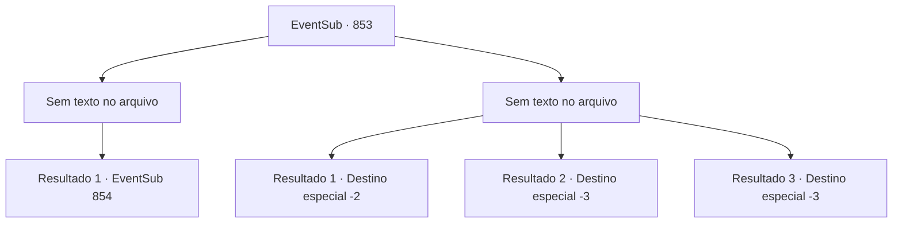

# Eventos secundários · 853

[Índice da tabela](index.md) · [Índice geral](../index.md)

ID: `pt:EventSub:853` · Fonte: `EventSub4` · Versão: 1.2.47.

Mapeamento estático dos arquivos; a disponibilidade e a execução dependem do estado da run.

## Texto do evento

*Sem texto no arquivo.*

## Dados de entrada

```json
{
  "id": 853,
  "grade": 1,
  "subEvent": "",
  "required": ""
}
```

## Mapa das escolhas



## Escolhas e resultados

### Escolha 1

*Sem texto no arquivo; o papel dessa opção depende da interface do jogo.*

Requisitos e outros campos da escolha:

```json
{
  "required": ""
}
```

#### Resultado 1.1

Você derrota Shao, mas a situação ainda não acabou. Os Dragões Vermelhos agora te cercaram. Enquanto você subjugava Shao, eles fizeram o mesmo com Lei. Com Lei ajoelhado no chão, os Dragões Vermelhos se mantêm vitoriosos. Você e os guerreiros parecem estar em um impasse. Então, um espadachim com uma cicatriz na bochecha avança e fala. 

 "Nós oferecemos uma trégua!"


Continuação registrada: [Evento 854](0854.md) na mesma tabela.

```json
{
  "required": "",
  "chance": "1",
  "nextEvent": 854,
  "type": 2,
  "reward": ""
}
```

### Escolha 2

*Sem texto no arquivo; o papel dessa opção depende da interface do jogo.*

Requisitos e outros campos da escolha:

```json
{
  "required": ""
}
```

#### Resultado 2.1


 "...SOHYEOP!!"

 Você percebe que um ataque feroz está vindo em sua direção. Lei grita um aviso para você. Mesmo lutando sozinho, ele conseguiu perceber o perigo em que você está. Mas você é incapaz de reagir ao ataque. O sangue jorra, e a dor te faz perder a consciência. 

 'SPLASH!' 

 Você finalmente acorda e tosse a água para fora dos pulmões. Você deve ter engolido muito. Sua cabeça ainda está tonta. Recuperando o fôlego, você olha ao redor. Você deve ter sido levado para outra enseada. Shao, Lei e os outros não estão em lugar nenhum. Você rapidamente acende uma pequena fogueira para se secar e sai silenciosamente.

Continuação registrada: [Destino especial `-2`](../destinos-especiais.md).

```json
{
  "required": "1_0_2|1_1_2",
  "chance": "1",
  "nextEvent": -2,
  "type": 2,
  "reward": "0_0_-1|0_1_-1|12_11_-1"
}
```

#### Resultado 2.2

Afiada lâmina de uma espada perfura seu pescoço. Você engasga com seu próprio sangue. Shao puxa sua espada de sua garganta e desfere outro golpe poderoso. Você encontra seu fim, sangue explodindo de seus ferimentos.

Continuação registrada: [Destino especial `-3`](../destinos-especiais.md).

```json
{
  "required": "2_0_2",
  "chance": "1",
  "nextEvent": -3,
  "type": 2,
  "reward": "0_0_-1|0_1_-1"
}
```

#### Resultado 2.3

Afiada lâmina de uma espada perfura seu pescoço. Você engasga com seu próprio sangue. Shao puxa sua espada da sua garganta e desfere outro golpe poderoso. Você encontra seu fim, sangue explodindo de seus ferimentos.

Continuação registrada: [Destino especial `-3`](../destinos-especiais.md).

```json
{
  "required": "2_1_2",
  "chance": "1",
  "nextEvent": -3,
  "type": 2,
  "reward": "0_0_-1|0_1_-1"
}
```

## Referências que chegam a este evento

- [Evento 852 · escolha 2 · resultado 1](0852.md#escolha-2)
- [Evento 852 · escolha 2 · resultado 2](0852.md#escolha-2)
- [Evento 852 · escolha 2 · resultado 3](0852.md#escolha-2)
