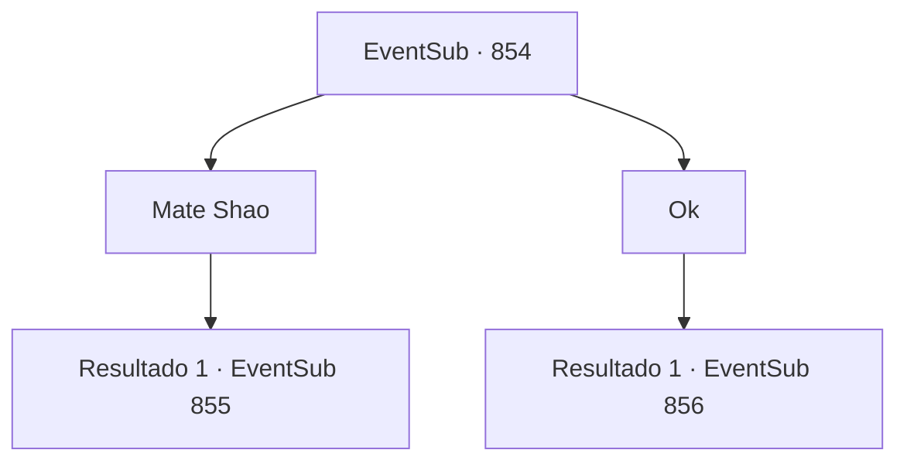

# Eventos secundários · 854

[Índice da tabela](index.md) · [Índice geral](../index.md)

ID: `pt:EventSub:854` · Fonte: `EventSub4` · Versão: 1.2.47.

Mapeamento estático dos arquivos; a disponibilidade e a execução dependem do estado da run.

## Texto do evento

*Sem texto no arquivo.*

## Dados de entrada

```json
{
  "id": 854,
  "grade": 1,
  "subEvent": "",
  "required": ""
}
```

## Mapa das escolhas



## Escolhas e resultados

### Escolha 1

Mate Shao

Requisitos e outros campos da escolha:

```json
{
  "required": "2_3_0"
}
```

#### Resultado 1.1

Você ignora o pedido dele e corta o pescoço de Shao com a espada dela.   Um jorro de sangue carmesim espirra por todo o seu rosto e roupas. O cheiro de ferro é sentido ao seu redor.   

 "... M- MEU SENHOR...!!"

   Tendo perdido seu líder, os guerreiros começam a avançar contra você com raiva.

Continuação registrada: [Evento 855](0855.md) na mesma tabela.

```json
{
  "required": "",
  "chance": "1",
  "nextEvent": 855,
  "type": 2,
  "reward": "6_0_179",
  "place": 8
}
```

### Escolha 2

Ok

Requisitos e outros campos da escolha:

```json
{
  "required": ""
}
```

#### Resultado 2.1

Você aceita a oferta do Dragão Vermelho. Felizmente, nenhum dos lados decide atacar durante a troca de reféns. 

 "O-obrigado, Sohyeop. Mas devemos sair daqui. Quem sabe o que eles vão fazer agora que têm Shao de volta."

 Você e Lei rapidamente deixam a área. 

 Os dois encontram uma caverna próxima e decidem se esconder lá. Lei, ainda ofegante, fala. 

 "*ofega*... *ofega*... Vamos... vamos fazer uma pausa."


Continuação registrada: [Evento 856](0856.md) na mesma tabela.

```json
{
  "required": "",
  "chance": "1",
  "nextEvent": 856,
  "type": 0,
  "reward": ""
}
```

## Referências que chegam a este evento

- [Evento 853 · escolha 1 · resultado 1](0853.md#escolha-1)
