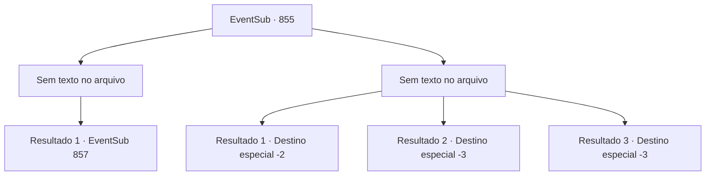

# Eventos secundários · 855

[Índice da tabela](index.md) · [Índice geral](../index.md)

ID: `pt:EventSub:855` · Fonte: `EventSub4` · Versão: 1.2.47.

Mapeamento estático dos arquivos; a disponibilidade e a execução dependem do estado da run.

## Texto do evento

*Sem texto no arquivo.*

## Dados de entrada

```json
{
  "id": 855,
  "grade": 1,
  "subEvent": "",
  "required": ""
}
```

## Mapa das escolhas



## Escolhas e resultados

### Escolha 1

*Sem texto no arquivo; o papel dessa opção depende da interface do jogo.*

Requisitos e outros campos da escolha:

```json
{
  "required": ""
}
```

#### Resultado 1.1

Você entrega os Dracos Vermelhos para onde seu senhor está. A praia de areia agora está coberta de sangue vermelho. Você se vira para Lei, também coberto de sangue. Ele está parado, olhando silenciosamente para a pilha de corpos que você empilhou.

Continuação registrada: [Evento 857](0857.md) na mesma tabela.

```json
{
  "required": "",
  "chance": "1",
  "nextEvent": 857,
  "type": 2,
  "reward": ""
}
```

### Escolha 2

*Sem texto no arquivo; o papel dessa opção depende da interface do jogo.*

Requisitos e outros campos da escolha:

```json
{
  "required": ""
}
```

#### Resultado 2.1

Você recupera o fôlego e olha ao redor. Há boas e más notícias. A boa notícia é que, apesar de ter perdido a luta, você conseguiu romper a linha de defesa e escapar. A má notícia é que você não faz ideia de para onde Lei foi.  

 'GRRRRRR. *RUMBLE*' 

 De repente, um raio aparece no céu. Logo é seguido por uma chuva forte, tão intensa que você tem dificuldade em manter os olhos abertos. Você deve encontrar um lugar seguro para esperar a tempestade passar. Você olha de volta na direção do esconderijo e anda mais rápido.

Continuação registrada: [Destino especial `-2`](../destinos-especiais.md).

```json
{
  "required": "1_0_2|1_1_2",
  "chance": "1",
  "nextEvent": -2,
  "type": 2,
  "reward": "0_0_-1|0_1_-1|12_11_-1"
}
```

#### Resultado 2.2

Nem mesmo a chuva forte conseguiu acalmar a ira dos guerreiros. Eles se concentram apenas em atacá-lo ferozmente, sem se preocupar em se defender contra suas lutas. Você faz o seu melhor para revidar, mas é impossível manter todos afastados. Infelizmente, seu corpo é atingido por uma espada vindo em sua direção.

Continuação registrada: [Destino especial `-3`](../destinos-especiais.md).

```json
{
  "required": "2_0_2",
  "chance": "1",
  "nextEvent": -3,
  "type": 2,
  "reward": "0_0_-1|0_1_-1"
}
```

#### Resultado 2.3

Nem mesmo a chuva forte conseguiu acalmar a ira dos guerreiros. Eles se concentram apenas em atacá-lo ferozmente, sem se preocupar em se defender contra suas lutas. Você faz o seu melhor para revidar, mas é impossível manter todos afastados. Infelizmente, seu corpo é atingido por uma espada vindo em sua direção.

Continuação registrada: [Destino especial `-3`](../destinos-especiais.md).

```json
{
  "required": "2_1_2",
  "chance": "1",
  "nextEvent": -3,
  "type": 2,
  "reward": "0_0_-1|0_1_-1"
}
```

## Referências que chegam a este evento

- [Evento 854 · escolha 1 · resultado 1](0854.md#escolha-1)
