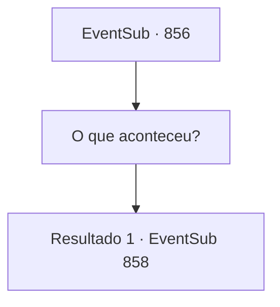

# Eventos secundários · 856

[Índice da tabela](index.md) · [Índice geral](../index.md)

ID: `pt:EventSub:856` · Fonte: `EventSub4` · Versão: 1.2.47.

Mapeamento estático dos arquivos; a disponibilidade e a execução dependem do estado da run.

## Texto do evento

*Sem texto no arquivo.*

## Dados de entrada

```json
{
  "id": 856,
  "grade": 1,
  "subEvent": "",
  "required": ""
}
```

## Mapa das escolhas



## Escolhas e resultados

### Escolha 1

O que aconteceu?

Requisitos e outros campos da escolha:

```json
{
  "required": ""
}
```

#### Resultado 1.1

Você pede uma explicação a Lei. Sobre o que aconteceu depois que você e ele foram separados, para ser exato. Lei te responde, com um olhar preocupado. 

 "...É exatamente como eu disse antes. Shao conseguiu me rastrear e me emboscou enquanto eu estava treinando. E então... bem, você sabe o resto, Sohyeop."

 Depois de terminar sua explicação, Lei solta um longo suspiro. 

 "Mesmo que eu fugisse novamente, Shao continuará vindo atrás de mim. Pelo menos enquanto ela estiver viva... O que fazer, o que fazer..."


Continuação registrada: [Evento 858](0858.md) na mesma tabela.

```json
{
  "required": "",
  "chance": "1",
  "nextEvent": 858,
  "type": 2,
  "reward": ""
}
```

## Referências que chegam a este evento

- [Evento 854 · escolha 2 · resultado 1](0854.md#escolha-2)
