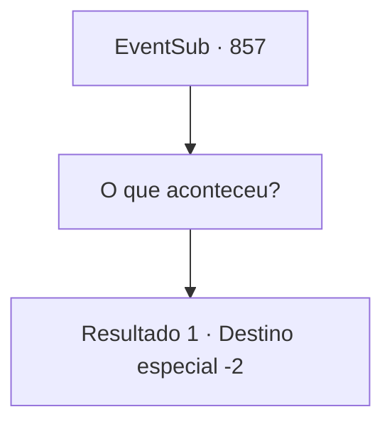

# Eventos secundários · 857

[Índice da tabela](index.md) · [Índice geral](../index.md)

ID: `pt:EventSub:857` · Fonte: `EventSub4` · Versão: 1.2.47.

Mapeamento estático dos arquivos; a disponibilidade e a execução dependem do estado da run.

## Texto do evento

*Sem texto no arquivo.*

## Dados de entrada

```json
{
  "id": 857,
  "grade": 1,
  "subEvent": "",
  "required": ""
}
```

## Mapa das escolhas



## Escolhas e resultados

### Escolha 1

O que aconteceu?

Requisitos e outros campos da escolha:

```json
{
  "required": ""
}
```

#### Resultado 1.1

Você pede uma explicação a Lei. Sobre o que aconteceu depois que você e ele foram separados, para ser exato. Lei te responde, com um olhar preocupado. 

 "...É exatamente como eu disse antes. Shao conseguiu me rastrear e me emboscou enquanto eu estava treinando. Nunca esperei que as coisas ficassem tão ruins..."

 Lei esfrega o rosto com as mãos trêmulas. Então, ele solta um longo suspiro. 

 "Phew... Bem... Obrigado por salvar minha vida, Sohyeop. Agora, se me der licença..."

 Ele então se afasta, cambaleando.

Continuação registrada: [Destino especial `-2`](../destinos-especiais.md).

```json
{
  "required": "",
  "chance": "1",
  "nextEvent": -2,
  "type": 2,
  "reward": "12_11_7"
}
```

## Referências que chegam a este evento

- [Evento 855 · escolha 1 · resultado 1](0855.md#escolha-1)
