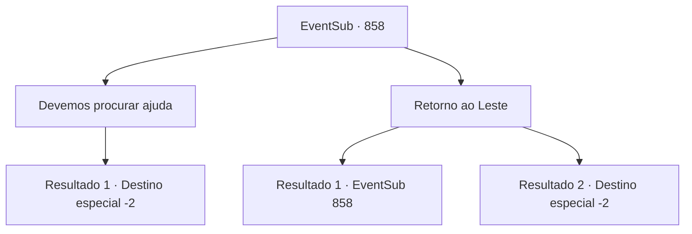

# Eventos secundários · 858

[Índice da tabela](index.md) · [Índice geral](../index.md)

ID: `pt:EventSub:858` · Fonte: `EventSub4` · Versão: 1.2.47.

Mapeamento estático dos arquivos; a disponibilidade e a execução dependem do estado da run.

## Texto do evento

*Sem texto no arquivo.*

## Dados de entrada

```json
{
  "id": 858,
  "grade": 1,
  "subEvent": "",
  "required": ""
}
```

## Mapa das escolhas



## Escolhas e resultados

### Escolha 1

Devemos procurar ajuda

Requisitos e outros campos da escolha:

```json
{
  "required": ""
}
```

#### Resultado 1.1

Você sugere que Lei procure um lugar para proteção. Lei pensa por um segundo e fala. 

 "...Ouvi dizer que há um tabernáculo dedicado a Veene em Gladio. De acordo com os rumores que ouvi, eles sempre ajudam aqueles que procuram por isso."

 Lei explica que os crentes de Veene, a deusa do amor e da misericórdia, têm uma longa história de relacionamentos próximos com muitos, graças à sua disposição em ajudar as pessoas. Ou seja, você pode contar com eles para ajudá-lo quando as coisas ficarem ruins. 

 "Vou arriscar com eles."

 Com um novo destino em mente, Lei se prepara para partir. Você sente determinação nele. 

 "Eu... perdi a conta de quantas vezes você me ajudou, Sohyeop. Eu te agradeço, de todo o coração. Se você algum dia visitar Gladio, por favor - procure por mim lá."

 Quando Lei parte, a chuva já parou. Ele se curva uma última vez antes de partir.

Continuação registrada: [Destino especial `-2`](../destinos-especiais.md).

```json
{
  "required": "",
  "chance": "1",
  "nextEvent": -2,
  "type": 2,
  "reward": "12_11_9"
}
```

### Escolha 2

Retorno ao Leste

Requisitos e outros campos da escolha:

```json
{
  "required": "5_736_0"
}
```

#### Resultado 2.1

Você sugere que Lei volte para o Leste. Mas Lei balança a cabeça em resposta. 

 "Não acho que seja uma boa ideia. Enquanto Shao estiver tentando me matar, ela vai virar o Leste de cabeça para baixo se for preciso."


Continuação registrada: [Evento 858](0858.md) na mesma tabela.

```json
{
  "required": "",
  "chance": "16",
  "nextEvent": 858,
  "type": 1,
  "reward": "5_736_10"
}
```

#### Resultado 2.2

Você sugere que Lei volte para o Leste. Lei ouve você em silêncio, então acena com a cabeça em concordância. 

 "Sabe de uma coisa? Isso parece uma boa ideia, Sohyeop. Eu... perdi a conta de quantas vezes você me ajudou, Sohyeop. Eu te agradeço, de todo o coração. Sério. E... boa sorte para você também."

 Quando Lei parte, a chuva já parou. Ele se inclina uma última vez antes de ir embora.

Continuação registrada: [Destino especial `-2`](../destinos-especiais.md).

```json
{
  "required": "",
  "chance": "1|0_7_1",
  "nextEvent": -2,
  "type": 0,
  "reward": "12_11_-1|14_11_2"
}
```

## Referências que chegam a este evento

- [Evento 856 · escolha 1 · resultado 1](0856.md#escolha-1)
- [Evento 858 · escolha 2 · resultado 1](0858.md#escolha-2)
