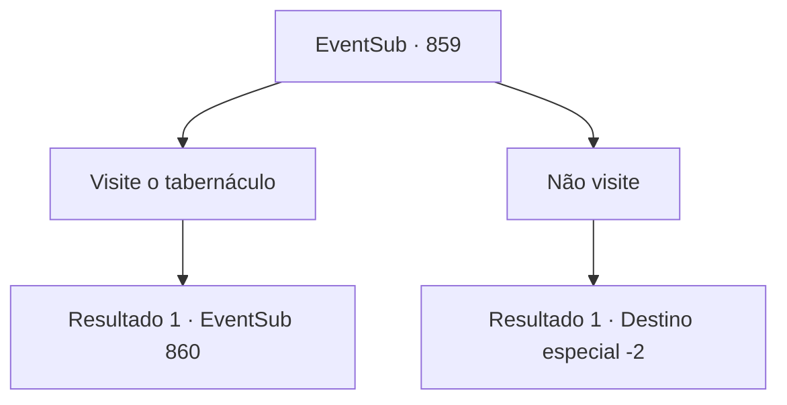

# Eventos secundários · 859

[Índice da tabela](index.md) · [Índice geral](../index.md)

ID: `pt:EventSub:859` · Fonte: `EventSub4` · Versão: 1.2.47.

Mapeamento estático dos arquivos; a disponibilidade e a execução dependem do estado da run.

## Texto do evento

Sua aventura acontece para levá-lo à área perto de Gladio. Bem longe, você vê o tabernáculo dedicado a Veene, a Deusa do Amor e da Misericórdia, colocado no topo de uma colina. Você se lembra das palavras de Lei, pedindo para você fazer uma visita a ele.

## Dados de entrada

```json
{
  "id": 859,
  "grade": 1,
  "subEvent": "",
  "required": "12_11_9|1_2_45"
}
```

## Mapa das escolhas



## Escolhas e resultados

### Escolha 1

Visite o tabernáculo

Requisitos e outros campos da escolha:

```json
{
  "required": ""
}
```

#### Resultado 1.1

Você sobe a colina e chega ao tabernáculo de Veene. 

 "Seja bem-vindo, companheiro crente."

 Você é guiado por um sacerdote na entrada, para dentro do tabernáculo. O lugar é construído de forma ascética, embora você note algumas rachaduras aqui e ali devido ao prédio ser antigo. Ainda assim, o interior é limpo e organizado. Os sacerdotes devem estar cuidando bem. 

 "Ah, Sohyeop!"

 Enquanto você passa pela sala de armazenamento, encontra um rosto familiar. É Lei, vestindo uma túnica de sacerdote surrada, movendo cuidadosamente pilhas de tomos empoeirados. 

 "Oh, onde estão meus modos. Eu odiaria fazê-lo esperar, mas ainda tenho algum trabalho a fazer."


Continuação registrada: [Evento 860](0860.md) na mesma tabela.

```json
{
  "required": "",
  "chance": "1",
  "nextEvent": 860,
  "type": 2,
  "reward": ""
}
```

### Escolha 2

Não visite

Requisitos e outros campos da escolha:

```json
{
  "required": ""
}
```

#### Resultado 2.1

Você decide não visitar o tabernáculo de Veene.

Continuação registrada: [Destino especial `-2`](../destinos-especiais.md).

```json
{
  "required": "",
  "chance": "1",
  "nextEvent": -2,
  "type": 2,
  "reward": "12_11_-1"
}
```

## Referências que chegam a este evento

Nenhum `nextEvent` positivo da mesma tabela aponta para este nó. Isso não prova que seja inacessível: sorteio e estado de história podem selecioná-lo.

