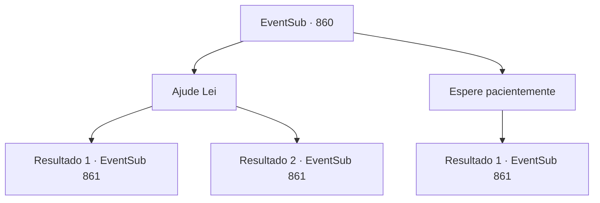

# Eventos secundários · 860

[Índice da tabela](index.md) · [Índice geral](../index.md)

ID: `pt:EventSub:860` · Fonte: `EventSub4` · Versão: 1.2.47.

Mapeamento estático dos arquivos; a disponibilidade e a execução dependem do estado da run.

## Texto do evento

*Sem texto no arquivo.*

## Dados de entrada

```json
{
  "id": 860,
  "grade": 1,
  "subEvent": "",
  "required": ""
}
```

## Mapa das escolhas



## Escolhas e resultados

### Escolha 1

Ajude Lei

Requisitos e outros campos da escolha:

```json
{
  "required": ""
}
```

#### Resultado 1.1

Lei parece estar encarregado de organizar o depósito. Você arregaça as mangas para dar uma mãozinha. O trabalho leva apenas cerca de uma hora, com quatro mãos em vez de duas. 

 "Ufa! Agradeço a ajuda, Sohyeop! Aqui, um símbolo de gratidão do tabernáculo."

 Você pega a poção e pergunta a Lei o que aconteceu. Ele tenta dizer algo, mas para, apontando para o outro lado do depósito. 

 "Tenho muito a dizer, mas não acho que este seja um bom lugar para tal conversa. Vamos nos mover, certo?"

 Poucos momentos depois, você e Lei caminham para o pátio interno e colocam a conversa em dia. Lei explica que pediu proteção no tabernáculo de Veene, ao qual os sacerdotes concordaram em fornecer, em troca de Lei fazer alguns serviços para o tabernáculo. 

 "A Sacerdotisa Chefe até decidiu chamar a ajuda de um paladino, para proteção adicional. Você não precisará se preocupar comigo por um tempo. Está seguro aqui."


Continuação registrada: [Evento 861](0861.md) na mesma tabela.

```json
{
  "required": "",
  "chance": "1|0_5_1",
  "nextEvent": 861,
  "type": 0,
  "reward": "3_190_1"
}
```

#### Resultado 1.2

Lei parece estar encarregado de organizar o depósito. Você arregaça as mangas para dar uma mãozinha a ele. Mas você continua cometendo erros, atrapalhando o trabalho em vez de ajudar. 

 "...Eu cuidarei disso. Por favor, espere por mim no pátio interno, Sohyeop."

 Você ouve a oferta educada de Lei e vai para lá. É um lugarzinho agradável, adornado com uma pequena fonte e campos de flores. Você espera lá por cerca de uma hora. Lei se aproxima, seu trabalho concluído. 

 "Ufa... Desculpe por te fazer esperar, Sohyeop."

 Você e Lei encontram um lugar no pátio e colocam a conversa em dia. Lei explica que pediu proteção no tabernáculo de Veene, ao qual os sacerdotes concordaram em fornecer, em troca de Lei fazer alguns serviços para o tabernáculo. 

 "A Sumo Sacerdotisa até decidiu chamar a ajuda de um paladino, para proteção adicional. Você não precisará se preocupar comigo por um tempo. É seguro aqui."


Continuação registrada: [Evento 861](0861.md) na mesma tabela.

```json
{
  "required": "",
  "chance": "10",
  "nextEvent": 861,
  "type": 1,
  "reward": ""
}
```

### Escolha 2

Espere pacientemente

Requisitos e outros campos da escolha:

```json
{
  "required": ""
}
```

#### Resultado 2.1

Parece que Lei está encarregado de organizar o depósito. Você decide não incomodá-lo e se dirige ao pátio interno. É um lugarzinho agradável, adornado com uma pequena fonte e campos de flores. Você espera lá por cerca de uma hora. Lei se aproxima, seu trabalho concluído. 

 "Ufa... Desculpe por te fazer esperar, Sohyeop."

 Você e Lei encontram um lugar no pátio e colocam a conversa em dia. Lei explica que pediu proteção no tabernáculo de Veene, ao qual os sacerdotes concordaram em fornecer, em troca de Lei fazer alguns serviços para o tabernáculo. 

 "A Sumo Sacerdotisa até decidiu chamar a ajuda de um paladino, para proteção adicional. Você não precisará se preocupar comigo por um tempo. É seguro aqui."


Continuação registrada: [Evento 861](0861.md) na mesma tabela.

```json
{
  "required": "",
  "chance": "1",
  "nextEvent": 861,
  "type": 2,
  "reward": ""
}
```

## Referências que chegam a este evento

- [Evento 859 · escolha 1 · resultado 1](0859.md#escolha-1)
