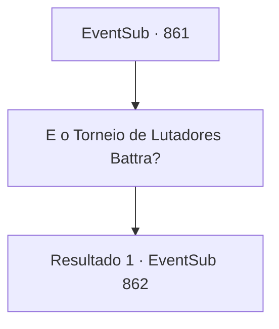

# Eventos secundários · 861

[Índice da tabela](index.md) · [Índice geral](../index.md)

ID: `pt:EventSub:861` · Fonte: `EventSub4` · Versão: 1.2.47.

Mapeamento estático dos arquivos; a disponibilidade e a execução dependem do estado da run.

## Texto do evento

*Sem texto no arquivo.*

## Dados de entrada

```json
{
  "id": 861,
  "grade": 1,
  "subEvent": "",
  "required": ""
}
```

## Mapa das escolhas



## Escolhas e resultados

### Escolha 1

E o Torneio de Lutadores Battra?

Requisitos e outros campos da escolha:

```json
{
  "required": ""
}
```

#### Resultado 1.1

Você pergunta a Lei sobre o Torneio de Lutadores Battra. Ele responde com um sorriso amargo, balançando a cabeça. 

 "Infelizmente, a competição já acabou. Eu nem me inscrevi. Tinha medo de ser atacado no meio dela. A Sacerdotisa Chefe me disse que um cavaleiro de um reino distante ganhou o primeiro lugar. Ah, e... aparentemente, Shao chegou à final, mas perdeu."

 Ele faz o melhor para parecer bem, mas você sente decepção.

Continuação registrada: [Evento 862](0862.md) na mesma tabela.

```json
{
  "required": "",
  "chance": "1",
  "nextEvent": 862,
  "type": 2,
  "reward": ""
}
```

## Referências que chegam a este evento

- [Evento 860 · escolha 1 · resultado 1](0860.md#escolha-1)
- [Evento 860 · escolha 1 · resultado 2](0860.md#escolha-1)
- [Evento 860 · escolha 2 · resultado 1](0860.md#escolha-2)
