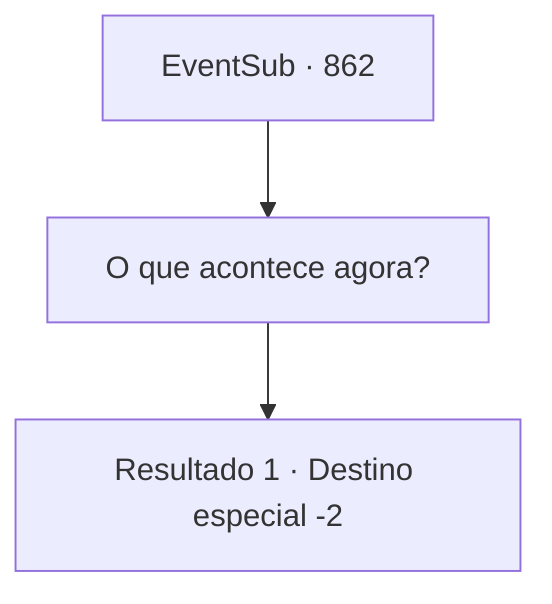

# Eventos secundários · 862

[Índice da tabela](index.md) · [Índice geral](../index.md)

ID: `pt:EventSub:862` · Fonte: `EventSub4` · Versão: 1.2.47.

Mapeamento estático dos arquivos; a disponibilidade e a execução dependem do estado da run.

## Texto do evento

*Sem texto no arquivo.*

## Dados de entrada

```json
{
  "id": 862,
  "grade": 1,
  "subEvent": "",
  "required": ""
}
```

## Mapa das escolhas



## Escolhas e resultados

### Escolha 1

O que acontece agora?

Requisitos e outros campos da escolha:

```json
{
  "required": ""
}
```

#### Resultado 1.1

Lei responde, olhando para o chão.   

 "Estou pensando em ficar aqui por um tempo.   Pelo menos, até Shao decidir voltar para o Leste."

   Lei solta um suspiro e se levanta.   

 "Isso é para você, Sohyeop. Por tudo que você fez por mim. Por favor - aceite."

   Lei lhe entrega sua espada.   

 "Minha espada. Agora é sua."

   Ele lhe dá a arma, acrescentando que não terá mais uso para ela de qualquer forma.   

 "Agradeço novamente, Sohyeop. Que os destinos estejam a seu favor..."

   Você se despede de Lei e vai embora.

Continuação registrada: [Destino especial `-2`](../destinos-especiais.md).

```json
{
  "required": "",
  "chance": "1",
  "nextEvent": -2,
  "type": 2,
  "reward": "3_323_1|12_11_-1|14_11_1|14_11_12"
}
```

## Referências que chegam a este evento

- [Evento 861 · escolha 1 · resultado 1](0861.md#escolha-1)
