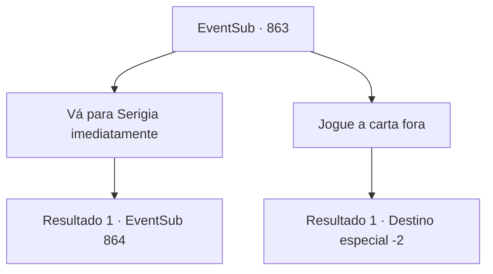

# Eventos secundários · 863

[Índice da tabela](index.md) · [Índice geral](../index.md)

ID: `pt:EventSub:863` · Fonte: `EventSub4` · Versão: 1.2.47.

Mapeamento estático dos arquivos; a disponibilidade e a execução dependem do estado da run.

## Texto do evento

Você vê um falcão voando em sua direção. Ele pousa suavemente em cima do seu braço, olhando para você. Você encontra uma carta amarrada em seus pés. Você abre a carta e descobre que quem a escreveu tem uma caligrafia elegante. 

 'Venha para Serigia, se quiser pagamento pelo último contrato. Shao Ryu.'

## Dados de entrada

```json
{
  "id": 863,
  "grade": 1,
  "subEvent": "",
  "required": "12_11_11"
}
```

## Mapa das escolhas



## Escolhas e resultados

### Escolha 1

Vá para Serigia imediatamente

Requisitos e outros campos da escolha:

```json
{
  "required": ""
}
```

#### Resultado 1.1

Você segue o falcão até Serigia. A cidade desértica, localizada ao lado de um oásis, já está lotada de pessoas. Os comerciantes sempre usaram este lugar como ponto de troca. Especialmente durante ocasiões especiais, como feriados ou festivais. Você anda pela cidade, procurando por Shao. Você a encontra no canto do oásis. 

 "Ah, você está aqui."

 Shao se vira para olhar para você, com os pés mergulhados no oásis. Deitada à sombra, ela bate no pequeno caixote ao lado dela.

Continuação registrada: [Evento 864](0864.md) na mesma tabela.

```json
{
  "required": "",
  "chance": "1",
  "nextEvent": 864,
  "type": 2,
  "reward": ""
}
```

### Escolha 2

Jogue a carta fora

Requisitos e outros campos da escolha:

```json
{
  "required": ""
}
```

#### Resultado 2.1

Você joga a carta fora e segue para o seu destino original.

Continuação registrada: [Destino especial `-2`](../destinos-especiais.md).

```json
{
  "required": "",
  "chance": "1",
  "nextEvent": -2,
  "type": 2,
  "reward": "12_11_-1"
}
```

## Referências que chegam a este evento

Nenhum `nextEvent` positivo da mesma tabela aponta para este nó. Isso não prova que seja inacessível: sorteio e estado de história podem selecioná-lo.

