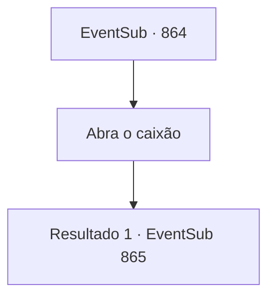

# Eventos secundários · 864

[Índice da tabela](index.md) · [Índice geral](../index.md)

ID: `pt:EventSub:864` · Fonte: `EventSub4` · Versão: 1.2.47.

Mapeamento estático dos arquivos; a disponibilidade e a execução dependem do estado da run.

## Texto do evento

*Sem texto no arquivo.*

## Dados de entrada

```json
{
  "id": 864,
  "grade": 1,
  "subEvent": "",
  "required": ""
}
```

## Mapa das escolhas



## Escolhas e resultados

### Escolha 1

Abra o caixão

Requisitos e outros campos da escolha:

```json
{
  "required": ""
}
```

#### Resultado 1.1

Você abre o pequeno recipiente. Dentro, você sente um frio antinatural que nunca esperaria em um deserto. Um Coração Congelado. Um item precioso, obtido ao abrir a barriga de um Dragão Branco e retirar seu coração. 

 "Você não tem ideia de quão difícil foi conseguir isso."

 Shao resmunga e espirra a água com os pés. 

 "Aparentemente, ele é usado neste continente como um artefato mágico. Mas minha cultura tem outra forma de usá-lo."

 Ela diz que pode moer o Coração Congelado e transformá-lo em uma pílula para ser ingerida. Verificando sua reação, Shao acrescenta. 

 "Claro, a escolha seria sua."


Continuação registrada: [Evento 865](0865.md) na mesma tabela.

```json
{
  "required": "",
  "chance": "1",
  "nextEvent": 865,
  "type": 2,
  "reward": "3_113_1"
}
```

## Referências que chegam a este evento

- [Evento 863 · escolha 1 · resultado 1](0863.md#escolha-1)
