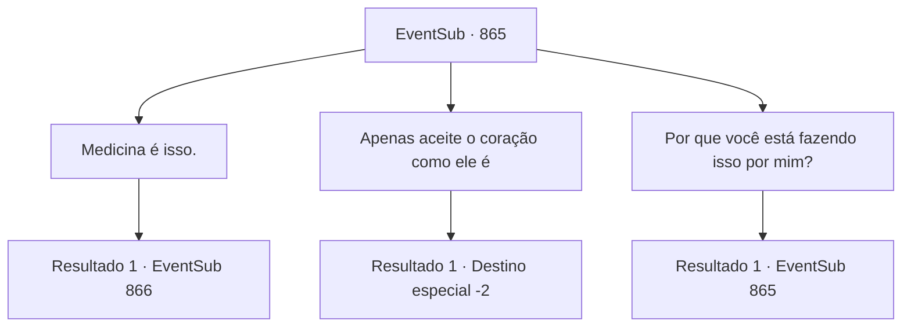

# Eventos secundários · 865

[Índice da tabela](index.md) · [Índice geral](../index.md)

ID: `pt:EventSub:865` · Fonte: `EventSub4` · Versão: 1.2.47.

Mapeamento estático dos arquivos; a disponibilidade e a execução dependem do estado da run.

## Texto do evento

*Sem texto no arquivo.*

## Dados de entrada

```json
{
  "id": 865,
  "grade": 1,
  "subEvent": "",
  "required": ""
}
```

## Mapa das escolhas



## Escolhas e resultados

### Escolha 1

Medicina é isso.

Requisitos e outros campos da escolha:

```json
{
  "required": ""
}
```

#### Resultado 1.1

Shao fecha o caixão e continua. 

 "Sim, o item é poderoso como está, mas para realmente obter seu poder, você precisa passar por algum... processamento."

 Shao avisa em um tom de voz grave, olhando para o caixão. 

 "Tenho que te avisar, no entanto. Ingerir não garantirá a transferência de poder. Raramente acontece, mas você pode tecnicamente morrer, como um efeito colateral. Se ainda quiser fazer isso, eu vou te ajudar."


Continuação registrada: [Evento 866](0866.md) na mesma tabela.

```json
{
  "required": "",
  "chance": "1",
  "nextEvent": 866,
  "type": 2,
  "reward": ""
}
```

### Escolha 2

Apenas aceite o coração como ele é

Requisitos e outros campos da escolha:

```json
{
  "required": ""
}
```

#### Resultado 2.1

Shao acena em resposta e se levanta. 

 "Agora... a dívida que eu tinha com você está quitada."

 Você pega o Coração Congelado e olha para Shao. Parece que ela ainda tem algum assunto pendente com você. Shao pergunta de forma desajeitada, quebrando o silêncio. 

 "Você está... pensando em participar do torneio?"

 Mas mesmo antes de você poder responder, ela continua. 

 "...Certifique-se de participar."

 Após fazer sua declaração, ela deixa o oásis.

Continuação registrada: [Destino especial `-2`](../destinos-especiais.md).

```json
{
  "required": "",
  "chance": "1",
  "nextEvent": -2,
  "type": 2,
  "reward": "12_11_12"
}
```

### Escolha 3

Por que você está fazendo isso por mim?

Requisitos e outros campos da escolha:

```json
{
  "required": "5_737_0"
}
```

#### Resultado 3.1

Você pergunta a ela por que está sendo tão cooperativa. Shao responde de forma direta. 

 "Por salvar minha vida, idiota."


Continuação registrada: [Evento 865](0865.md) na mesma tabela.

```json
{
  "required": "",
  "chance": "1",
  "nextEvent": 865,
  "type": 2,
  "reward": "5_737_10"
}
```

## Referências que chegam a este evento

- [Evento 864 · escolha 1 · resultado 1](0864.md#escolha-1)
- [Evento 865 · escolha 3 · resultado 1](0865.md#escolha-3)
