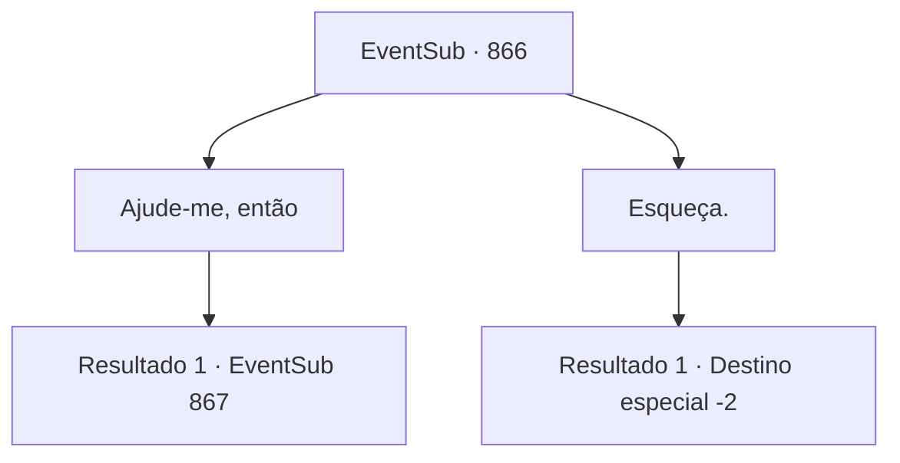

# Eventos secundários · 866

[Índice da tabela](index.md) · [Índice geral](../index.md)

ID: `pt:EventSub:866` · Fonte: `EventSub4` · Versão: 1.2.47.

Mapeamento estático dos arquivos; a disponibilidade e a execução dependem do estado da run.

## Texto do evento

*Sem texto no arquivo.*

## Dados de entrada

```json
{
  "id": 866,
  "grade": 1,
  "subEvent": "",
  "required": ""
}
```

## Mapa das escolhas



## Escolhas e resultados

### Escolha 1

Ajude-me, então

Requisitos e outros campos da escolha:

```json
{
  "required": ""
}
```

#### Resultado 1.1

Você dá a mesma resposta de antes. 

 "Entendido. Você terá que esperar."

 O remédio leva um dia inteiro para ser processado. Shao retorna para você com uma pequena caixa. Dentro há uma única pílula que emite frieza. 

 "É chamada de Pílula do Dragão Branco. Ou... uma 'esfera do dragão', é assim que vocês dizem por aqui?"


Continuação registrada: [Evento 867](0867.md) na mesma tabela.

```json
{
  "required": "",
  "chance": "1",
  "nextEvent": 867,
  "type": 2,
  "reward": "4_113_1|3_325_1"
}
```

### Escolha 2

Esqueça.

Requisitos e outros campos da escolha:

```json
{
  "required": ""
}
```

#### Resultado 2.1

Shao acena em resposta e se levanta. 

 "Agora... a dívida que eu tinha com você está quitada."

 Você pega o Coração Congelado e olha para Shao. Parece que ela ainda tem algum assunto pendente com você. Shao pergunta de forma desajeitada, quebrando o silêncio. 

 "Você está... pensando em participar do torneio?"

 Mas mesmo antes de você poder responder, ela continua. 

 "...Certifique-se de participar."

 Após fazer sua declaração, ela deixa o oásis.

Continuação registrada: [Destino especial `-2`](../destinos-especiais.md).

```json
{
  "required": "",
  "chance": "1",
  "nextEvent": -2,
  "type": 2,
  "reward": "12_11_12"
}
```

## Referências que chegam a este evento

- [Evento 865 · escolha 1 · resultado 1](0865.md#escolha-1)
