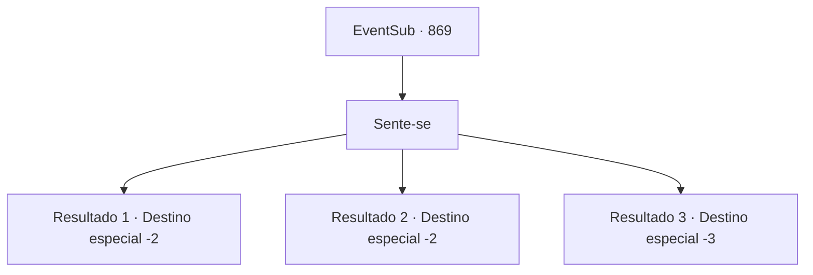

# Eventos secundários · 869

[Índice da tabela](index.md) · [Índice geral](../index.md)

ID: `pt:EventSub:869` · Fonte: `EventSub4` · Versão: 1.2.47.

Mapeamento estático dos arquivos; a disponibilidade e a execução dependem do estado da run.

## Texto do evento

*Sem texto no arquivo.*

## Dados de entrada

```json
{
  "id": 869,
  "grade": 1,
  "subEvent": "",
  "required": ""
}
```

## Mapa das escolhas



## Escolhas e resultados

### Escolha 1

Sente-se

Requisitos e outros campos da escolha:

```json
{
  "required": ""
}
```

#### Resultado 1.1

Você se senta e segue as instruções de Shao. 

 "Estabilize sua respiração. Sinta a energia fria fluindo pelo seu corpo. Quando fizer isso, deixe-a se espalhar. Não tente contê-la."

 Claro, mesmo com o conselho, controlar o poder não é uma tarefa fácil. É como se uma tempestade estivesse se formando dentro de você. 

Horas se passam. Você dominou o fluxo de energia fria e obteve controle total. Você lentamente abre os olhos, sentindo um nível completamente diferente de poder dentro de você. Shao absorve a aura restante e se levanta. 

 "Agora... a dívida que eu tinha com você está quitada."

 Você olha para Shao. Parece que ela ainda tem algum assunto pendente com você. Shao pergunta de forma desajeitada, quebrando o silêncio. 

 "Você está... pensando em participar do torneio?"

 Mas mesmo antes que você possa responder, ela continua. 

 "...Certifique-se de participar."

 Depois de fazer sua declaração, ela deixa o oásis.

Continuação registrada: [Destino especial `-2`](../destinos-especiais.md).

```json
{
  "required": "",
  "chance": "1|0_13_1",
  "nextEvent": -2,
  "type": 0,
  "reward": "0_2_1|0_5_1|0_13_1|22_8_2|12_11_12"
}
```

#### Resultado 1.2

Você se senta e segue as instruções de Shao. 

 "Estabilize sua respiração. Sinta a energia fria fluindo pelo seu corpo. Quando sentir, deixe-a se espalhar. Não tente contê-la."

 Claro, mesmo com o conselho, controlar o poder não é uma tarefa fácil. É como se uma tempestade estivesse se formando dentro de você. Uma tempestade grande demais para você lidar. Infelizmente, você tosse sangue, liberando a energia do seu corpo. Shao dá um tapinha nas suas costas, esvaziando o sangue frio da sua garganta. 

 "Bem, que pena. Mas agora... a dívida que eu tinha com você está quitada."

 Você olha para Shao. Parece que ela ainda tem algum assunto pendente com você. Shao pergunta de forma desajeitada, quebrando o silêncio. 

 "Você está... pensando em participar do torneio?"

 Mas mesmo antes de você poder responder, ela continua. 

 "...Certifique-se de participar."

 Depois de fazer sua declaração, ela deixa o oásis.

Continuação registrada: [Destino especial `-2`](../destinos-especiais.md).

```json
{
  "required": "1_0_2",
  "chance": "14",
  "nextEvent": -2,
  "type": 1,
  "reward": "0_0_-1|12_11_12"
}
```

#### Resultado 1.3

Você se senta e segue as instruções de Shao. Claro, mesmo com o conselho, controlar o poder não é uma tarefa fácil. É como se uma tempestade estivesse se formando dentro de você. Uma tempestade grande demais para você lidar. Infelizmente, você tosse sangue, liberando a energia do seu corpo. 

 "O quê...?! H- ei!"

 Shao corre até você, assustado, mas você não consegue recobrar a consciência.

Continuação registrada: [Destino especial `-3`](../destinos-especiais.md).

```json
{
  "required": "2_0_2",
  "chance": "14",
  "nextEvent": -3,
  "type": 1,
  "reward": "0_0_-1"
}
```

## Referências que chegam a este evento

- [Evento 867 · escolha 2 · resultado 1](0867.md#escolha-2)
- [Evento 868 · escolha 1 · resultado 1](0868.md#escolha-1)
- [Evento 868 · escolha 2 · resultado 1](0868.md#escolha-2)
