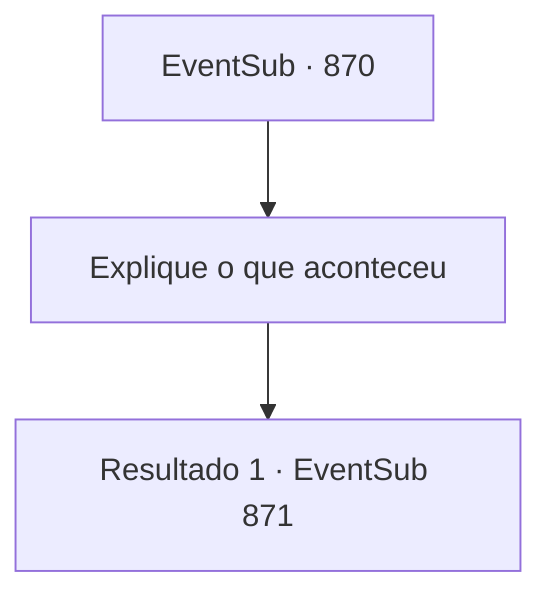

# Eventos secundários · 870

[Índice da tabela](index.md) · [Índice geral](../index.md)

ID: `pt:EventSub:870` · Fonte: `EventSub4` · Versão: 1.2.47.

Mapeamento estático dos arquivos; a disponibilidade e a execução dependem do estado da run.

## Texto do evento

|drawing_Gladio| Você finalmente chega a Gladio, a cidade localizada no extremo sul do Grande Deserto. O lugar já está em clima festivo, provavelmente por causa do torneio que está prestes a acontecer. Os comerciantes de caravanas montaram barracas temporárias como lojas. Os cidadãos locais já estão aproveitando as festividades, se deliciando com bebidas e música. Pousadas e tavernas estão ocupadas atraindo novos clientes. Você navega pelas ruas lotadas e vai até a arena. O edifício oval é construído em torno de uma estátua de pedra de Batt, o deus da guerra. 

 "...Sohyeop?! O que aconteceu? Pensei que você estivesse morto...! Você... caiu do penhasco!"

 Então, uma voz familiar é ouvida de trás. Você olha para trás e encontra Lei.

## Dados de entrada

```json
{
  "id": 870,
  "grade": 1,
  "subEvent": "",
  "required": "12_11_12"
}
```

## Mapa das escolhas



## Escolhas e resultados

### Escolha 1

Explique o que aconteceu

Requisitos e outros campos da escolha:

```json
{
  "required": ""
}
```

#### Resultado 1.1

Você explica tudo o que aconteceu para Lei.   Depois de ouvir sua história, Lei fica confuso.   Parece que ele ainda não tem ideia de como tratar Shao.   

 "Aí está você, {1}."

   Você nota uma mulher caminhando elegantemente em sua direção através da multidão.   É Shao.   Ela lança um olhar para Lei, depois se vira para você.   

 "Eu já te recompensei por salvar minha vida. Não vou pegar leve com você desta vez."

   Com um aviso resoluto, Shao se vira e vai embora.   Lei olha para as costas de Shao enquanto ela se afasta, depois suspira profundamente.   Então, ele estica os ombros e se vira para você.   

 "Você já se inscreveu para o torneio?"


Continuação registrada: [Evento 871](0871.md) na mesma tabela.

```json
{
  "required": "",
  "chance": "1",
  "nextEvent": 871,
  "type": 2,
  "reward": ""
}
```

## Referências que chegam a este evento

Nenhum `nextEvent` positivo da mesma tabela aponta para este nó. Isso não prova que seja inacessível: sorteio e estado de história podem selecioná-lo.

