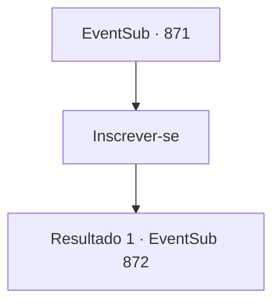

# Eventos secundários · 871

[Índice da tabela](index.md) · [Índice geral](../index.md)

ID: `pt:EventSub:871` · Fonte: `EventSub4` · Versão: 1.2.47.

Mapeamento estático dos arquivos; a disponibilidade e a execução dependem do estado da run.

## Texto do evento

*Sem texto no arquivo.*

## Dados de entrada

```json
{
  "id": 871,
  "grade": 1,
  "subEvent": "",
  "required": ""
}
```

## Mapa das escolhas



## Escolhas e resultados

### Escolha 1

Inscrever-se

Requisitos e outros campos da escolha:

```json
{
  "required": ""
}
```

#### Resultado 1.1

Você se aproxima da recepcionista e pede para se inscrever no torneio. Ela olha para o seu rosto, sorri e responde. 

 "Ah. Você deve ser {1}. Está tudo certo. Ainda há algum tempo antes das partidas começarem. Por que não descansa por enquanto?"

 Lei parece um pouco surpresa. 

 "Huh... Normalmente você teria que passar por uma seleção. Parece que fizeram uma exceção para você, Sohyeop. Agora, devo voltar ao meu treinamento."

 Lei se despede de você e vai embora. Alguns dias depois, chega o dia do torneio. 

 Você sobe ao palco, totalmente preparado. O público aplaude e vibra, sem um único assento vazio. Seu primeiro oponente é um aventureiro cujo nome você não conhece. 

 "Tenho sido um andarilho na última década. Já é hora de pensar em aposentadoria. Estou apenas tentando ganhar o prêmio em dinheiro para meu fundo de aposentadoria. Então, por favor, colabore comigo, hein?"

 Claro, ele não estava realmente pedindo sua cooperação. Você se prepara para a luta. O aventureiro avança contra você com suas lâminas gêmeas.

Continuação registrada: [Evento 872](0872.md) na mesma tabela.

```json
{
  "required": "",
  "chance": "1",
  "nextEvent": 872,
  "type": 2,
  "reward": "6_0_62",
  "place": 11
}
```

## Referências que chegam a este evento

- [Evento 870 · escolha 1 · resultado 1](0870.md#escolha-1)
