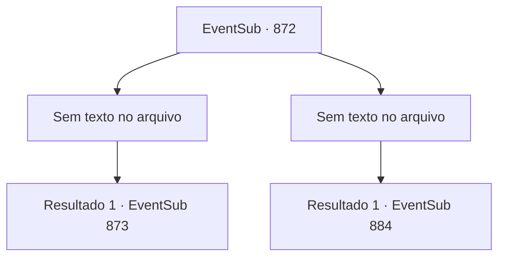

# Eventos secundários · 872

[Índice da tabela](index.md) · [Índice geral](../index.md)

ID: `pt:EventSub:872` · Fonte: `EventSub4` · Versão: 1.2.47.

Mapeamento estático dos arquivos; a disponibilidade e a execução dependem do estado da run.

## Texto do evento

*Sem texto no arquivo.*

## Dados de entrada

```json
{
  "id": 872,
  "grade": 1,
  "subEvent": "",
  "required": ""
}
```

## Mapa das escolhas



## Escolhas e resultados

### Escolha 1

*Sem texto no arquivo; o papel dessa opção depende da interface do jogo.*

Requisitos e outros campos da escolha:

```json
{
  "required": ""
}
```

#### Resultado 1.1

<link=shake>

 "WOOOOOOOOO!!!"

</link> Aplausos enchem a arena enquanto a luta termina. Nessa batalha feroz, você sai vitorioso, mas tem que admitir que foi por pouco. Você levanta o punho no ar para responder aos aplausos enquanto desce do palco. 

 As lutas continuam. Você assiste aos outros competidores lutarem, verificando seu próximo oponente. Seu oponente da luta final é um cavaleiro chamado 'Sir Sparkles'. Ele é um lutador muito habilidoso do Reino de Lothar, que já ocupou a posição de Capitão da Guarda Real.

Continuação registrada: [Evento 873](0873.md) na mesma tabela.

```json
{
  "required": "",
  "chance": "1",
  "nextEvent": 873,
  "type": 2,
  "reward": ""
}
```

### Escolha 2

*Sem texto no arquivo; o papel dessa opção depende da interface do jogo.*

Requisitos e outros campos da escolha:

```json
{
  "required": ""
}
```

#### Resultado 2.1

<link=shake>

 "WOOOOOOOOO!!!"

</link> Aplausos enchem a arena quando a luta termina. Sir Sparkles emerge vitorioso. Ele levanta o punho no ar para responder aos aplausos. Você o encara por alguns segundos antes de descer do palco. 

 "Hmm... Parece que eu subestimei sua habilidade."

 Shao te encontra com crítica. Pela primeira vez, ela parece genuinamente decepcionada com você. Em vez de responder a ela, você se dirige para os assentos dos espectadores.

Continuação registrada: [Evento 884](0884.md) na mesma tabela.

```json
{
  "required": "",
  "chance": "1",
  "nextEvent": 884,
  "type": 2,
  "reward": ""
}
```

## Referências que chegam a este evento

- [Evento 871 · escolha 1 · resultado 1](0871.md#escolha-1)
