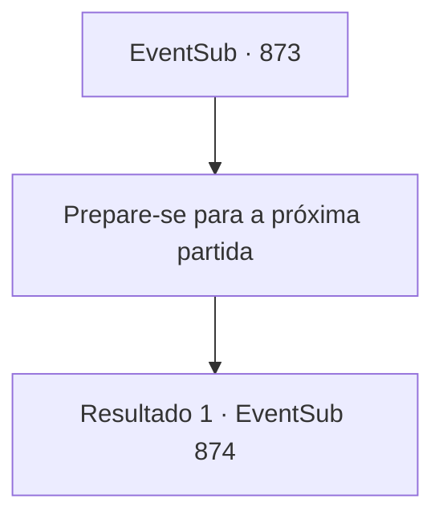

# Eventos secundários · 873

[Índice da tabela](index.md) · [Índice geral](../index.md)

ID: `pt:EventSub:873` · Fonte: `EventSub4` · Versão: 1.2.47.

Mapeamento estático dos arquivos; a disponibilidade e a execução dependem do estado da run.

## Texto do evento

*Sem texto no arquivo.*

## Dados de entrada

```json
{
  "id": 873,
  "grade": 1,
  "subEvent": "",
  "required": ""
}
```

## Mapa das escolhas



## Escolhas e resultados

### Escolha 1

Prepare-se para a próxima partida

Requisitos e outros campos da escolha:

```json
{
  "required": ""
}
```

#### Resultado 1.1

Sir Sparkles pode ter uma reputação como combatente, mas você não se importa. Você se prepara para a próxima batalha. 

 Finalmente, você sobe ao palco. Algumas pessoas da plateia estão gritando seu nome. Você se prepara para a luta. Seu oponente, que estava no palco antes de você, o cumprimenta em um tom formal. 

 "O nome é Sparkles, companheiro aventureiro! Eu venho do grande Reino de Lothar. Vamos ter uma luta honrada e justa."

 O homem está equipado com uma armadura completa e empunha uma enorme alabarda. Logo, a enorme arma balança em sua direção enquanto a luta final começa.

Continuação registrada: [Evento 874](0874.md) na mesma tabela.

```json
{
  "required": "",
  "chance": "1",
  "nextEvent": 874,
  "type": 2,
  "reward": "6_0_180",
  "place": 11
}
```

## Referências que chegam a este evento

- [Evento 872 · escolha 1 · resultado 1](0872.md#escolha-1)
