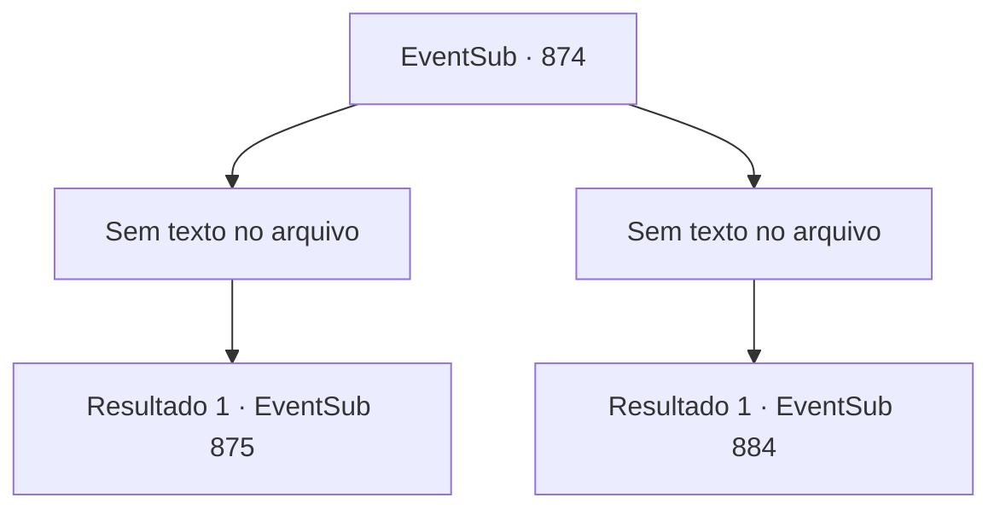

# Eventos secundários · 874

[Índice da tabela](index.md) · [Índice geral](../index.md)

ID: `pt:EventSub:874` · Fonte: `EventSub4` · Versão: 1.2.47.

Mapeamento estático dos arquivos; a disponibilidade e a execução dependem do estado da run.

## Texto do evento

*Sem texto no arquivo.*

## Dados de entrada

```json
{
  "id": 874,
  "grade": 1,
  "subEvent": "",
  "required": ""
}
```

## Mapa das escolhas



## Escolhas e resultados

### Escolha 1

*Sem texto no arquivo; o papel dessa opção depende da interface do jogo.*

Requisitos e outros campos da escolha:

```json
{
  "required": ""
}
```

#### Resultado 1.1

Sir Sparkles finalmente é levado aos joelhos. Você conseguiu derrotá-lo na batalha. Você levanta o punho no ar, anunciando sua vitória. Aplausos estrondosos irrompem da multidão. <link=shake>

 "WOOOOOOOOO!!!"

</link> Você se aproxima de Sir Sparkles e estende a mão. Suspirando, o cavaleiro fortemente armado a agarra relutantemente. Você o ajuda a se levantar e sai do palco. 

 As lutas continuam. Você verifica as outras lutas para deduzir quem seria seu oponente final. A próxima luta é entre Shao e Lei. Os dois competidores no palco sacam suas espadas e assumem uma postura semelhante. Eles parecem estar conversando sobre algo, mas você não consegue entender nada da conversa deles, principalmente devido ao barulho da multidão. Logo, a luta começa e um elegante e violento confronto de aço se segue.

Continuação registrada: [Evento 875](0875.md) na mesma tabela.

```json
{
  "required": "",
  "chance": "1",
  "nextEvent": 875,
  "type": 2,
  "reward": ""
}
```

### Escolha 2

*Sem texto no arquivo; o papel dessa opção depende da interface do jogo.*

Requisitos e outros campos da escolha:

```json
{
  "required": ""
}
```

#### Resultado 2.1

A pesada alabarda para bem antes da sua garganta. Sir Sparkles é anunciado como o vencedor. Aplausos estrondosos irrompem da multidão. <link=shake>

 "WOOOOOOOOO!!!"

</link> O cavaleiro fortemente armado levanta sua alabarda no ar em resposta. Você o observa silenciosamente por alguns segundos antes de descer do palco. 

 "Hmm... Parece que subestimei sua habilidade."

 Shao o encontra com crítica. Pela primeira vez, ela parece genuinamente decepcionada com você. Em vez de responder a ela, você se dirige para os assentos dos espectadores.

Continuação registrada: [Evento 884](0884.md) na mesma tabela.

```json
{
  "required": "",
  "chance": "1",
  "nextEvent": 884,
  "type": 2,
  "reward": ""
}
```

## Referências que chegam a este evento

- [Evento 873 · escolha 1 · resultado 1](0873.md#escolha-1)
