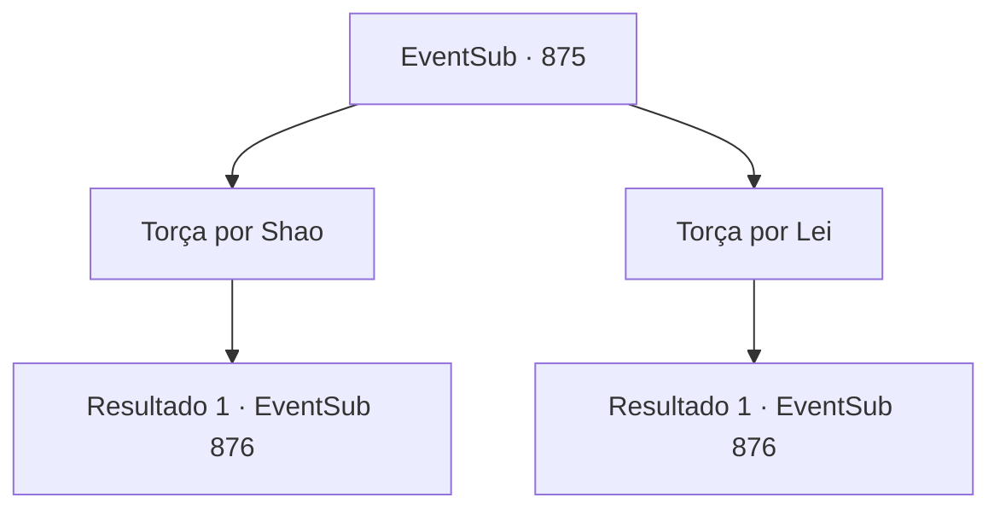

# Eventos secundários · 875

[Índice da tabela](index.md) · [Índice geral](../index.md)

ID: `pt:EventSub:875` · Fonte: `EventSub4` · Versão: 1.2.47.

Mapeamento estático dos arquivos; a disponibilidade e a execução dependem do estado da run.

## Texto do evento

*Sem texto no arquivo.*

## Dados de entrada

```json
{
  "id": 875,
  "grade": 1,
  "subEvent": "",
  "required": ""
}
```

## Mapa das escolhas



## Escolhas e resultados

### Escolha 1

Torça por Shao

Requisitos e outros campos da escolha:

```json
{
  "required": ""
}
```

#### Resultado 1.1

Você se levanta do seu assento e torce alto por Shao. 

 'SHAO! VAI EM FRENTE!!' 

 Como se estivesse respondendo à sua voz, Shao imediatamente começa a contra-atacar. Ela balança sua espada com ousadia, expondo-se a ferimentos no processo. Sua postura agressiva consegue libertar a espada de Lei de seu aperto. Shao é declarada a vencedora. <link=shake>

 "WOOOOOOOOO!!!"

</link> Uma salva de palmas estrondosa explode da multidão. Shao acena com as mãos no ar, respondendo aos aplausos. Então, ela te nota na plateia. Ela acolhe seu olhar com um sorriso gracioso. Lei encara Shao sem expressão por mais alguns segundos antes de lentamente sair da arena.

Continuação registrada: [Evento 876](0876.md) na mesma tabela.

```json
{
  "required": "",
  "chance": "1",
  "nextEvent": 876,
  "type": 2,
  "reward": "5_738_1"
}
```

### Escolha 2

Torça por Lei

Requisitos e outros campos da escolha:

```json
{
  "required": ""
}
```

#### Resultado 2.1

É realmente difícil dizer quem tem a vantagem no duelo, mas parece que Shao está lentamente começando a dominar Lei. Você se levanta do seu assento e torce alto por Lei. 

 'LEI! VOCÊ CONSEGUE!' 

 Apesar do seu incentivo, Lei não consegue reverter a maré da batalha e é derrotado. <link=shake>

 "WOOOOOOOOO!!!"

</link> Shao acena com as mãos no ar, respondendo aos aplausos. Lei encara Shao sem expressão por mais alguns segundos antes de lentamente sair da arena.

Continuação registrada: [Evento 876](0876.md) na mesma tabela.

```json
{
  "required": "",
  "chance": "1",
  "nextEvent": 876,
  "type": 2,
  "reward": ""
}
```

## Referências que chegam a este evento

- [Evento 874 · escolha 1 · resultado 1](0874.md#escolha-1)
