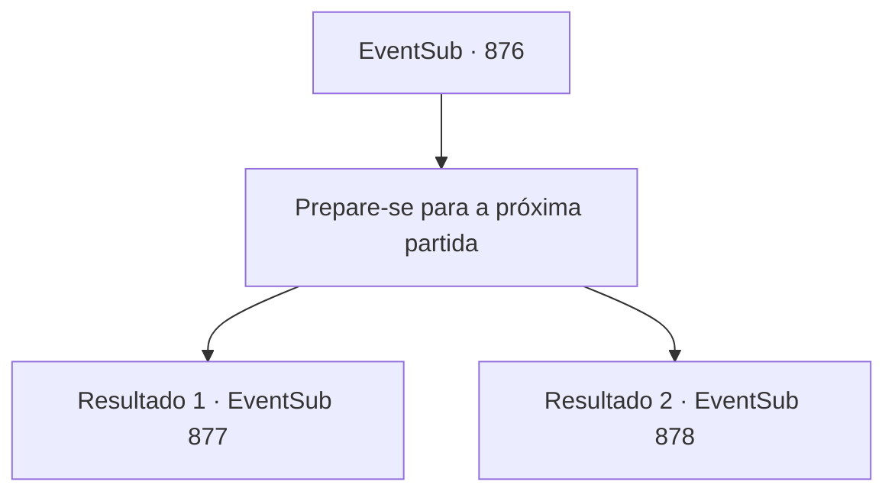

# Eventos secundários · 876

[Índice da tabela](index.md) · [Índice geral](../index.md)

ID: `pt:EventSub:876` · Fonte: `EventSub4` · Versão: 1.2.47.

Mapeamento estático dos arquivos; a disponibilidade e a execução dependem do estado da run.

## Texto do evento

*Sem texto no arquivo.*

## Dados de entrada

```json
{
  "id": 876,
  "grade": 1,
  "subEvent": "",
  "required": ""
}
```

## Mapa das escolhas



## Escolhas e resultados

### Escolha 1

Prepare-se para a próxima partida

Requisitos e outros campos da escolha:

```json
{
  "required": ""
}
```

#### Resultado 1.1

Você olha para Lei e Shao por alguns momentos antes de se afastar silenciosamente. Você recupera o fôlego e se prepara para a próxima luta. Totalmente preparado, você entra no palco. O calor da arena está no auge. O mesmo vale para o quão alto o público se tornou de tanta empolgação. Seu nome e o de seu oponente são gritados repetidamente. Ignorando os aplausos, você se prepara para lutar. Sua oponente da luta final, Shao Ryu, está calmamente esperando o início da luta com os olhos fechados. Quando você se aproxima dela, ela lentamente abre os olhos e olha para você. Um fervor estranho é sentido em seu olhar. 

 "Hmph... Eu teria vencido de qualquer maneira, mesmo sem sua palavra de encorajamento."

 Ela está colocando a culpa em você, mas nem tenta esconder o sorriso dos lábios. 

 "Antes de começarmos... Eu gostaria de lhe fazer uma sugestão. Por que não fazer uma pequena aposta comigo, hm? O perdedor deve conceder um desejo ao vencedor. O que acha disso?"


Continuação registrada: [Evento 877](0877.md) na mesma tabela.

```json
{
  "required": "5_738_1",
  "chance": "1",
  "nextEvent": 877,
  "type": 2,
  "reward": ""
}
```

#### Resultado 1.2

Você olha para Lei e Shao por alguns momentos antes de se afastar silenciosamente. Você recupera o fôlego e se prepara para a próxima luta. Totalmente preparado, você entra no palco. O calor da arena está no auge. O mesmo vale para o quão alto o público se tornou com a empolgação. Seu nome e o de seu oponente são gritados repetidamente. Ignorando os aplausos, você se prepara para lutar. Sua oponente da luta final, Shao Ryu, fala com uma voz irritada. 

 "Você deve estar tão triste por ver sua preciosa Lei derrotada."

 Você sente tanto decepção quanto raiva no rosto de Shao. Ela procede a sacar suas espadas e imediatamente avança contra você.

Continuação registrada: [Evento 878](0878.md) na mesma tabela.

```json
{
  "required": "18_738_1",
  "chance": "1",
  "nextEvent": 878,
  "type": 2,
  "reward": "6_0_183",
  "place": 11
}
```

## Referências que chegam a este evento

- [Evento 875 · escolha 1 · resultado 1](0875.md#escolha-1)
- [Evento 875 · escolha 2 · resultado 1](0875.md#escolha-2)
