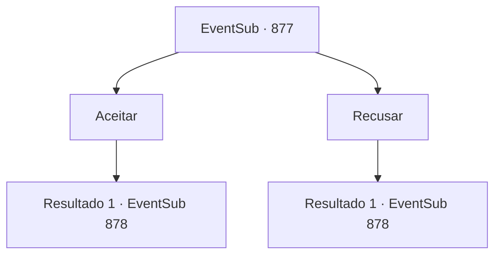

# Eventos secundários · 877

[Índice da tabela](index.md) · [Índice geral](../index.md)

ID: `pt:EventSub:877` · Fonte: `EventSub4` · Versão: 1.2.47.

Mapeamento estático dos arquivos; a disponibilidade e a execução dependem do estado da run.

## Texto do evento

*Sem texto no arquivo.*

## Dados de entrada

```json
{
  "id": 877,
  "grade": 1,
  "subEvent": "",
  "required": ""
}
```

## Mapa das escolhas



## Escolhas e resultados

### Escolha 1

Aceitar

Requisitos e outros campos da escolha:

```json
{
  "required": ""
}
```

#### Resultado 1.1

Você aceita a aposta de Shao e se prepara para a luta. Com um leve sorriso no rosto, Shao aperta o punho em sua arma. 

 "Bom. Espero que você esteja bem preparado. Porque o que eu quero... é bastante valioso."

 Com a espada de Shao voando em sua direção como um flash, a luta final começa.

Continuação registrada: [Evento 878](0878.md) na mesma tabela.

```json
{
  "required": "",
  "chance": "1",
  "nextEvent": 878,
  "type": 2,
  "reward": "5_738_2|6_0_183",
  "place": 11
}
```

### Escolha 2

Recusar

Requisitos e outros campos da escolha:

```json
{
  "required": ""
}
```

#### Resultado 2.1

Você rejeita a aposta de Shao e se prepara para a luta. Ela estala a língua em desapontamento e aperta o punho em sua espada. 

 "Tsk, tudo bem... Tanto faz."

 Com a espada de Shao voando em sua direção como um relâmpago, a partida final começa.

Continuação registrada: [Evento 878](0878.md) na mesma tabela.

```json
{
  "required": "",
  "chance": "1",
  "nextEvent": 878,
  "type": 2,
  "reward": "5_738_9|6_0_183",
  "place": 11
}
```

## Referências que chegam a este evento

- [Evento 876 · escolha 1 · resultado 1](0876.md#escolha-1)
