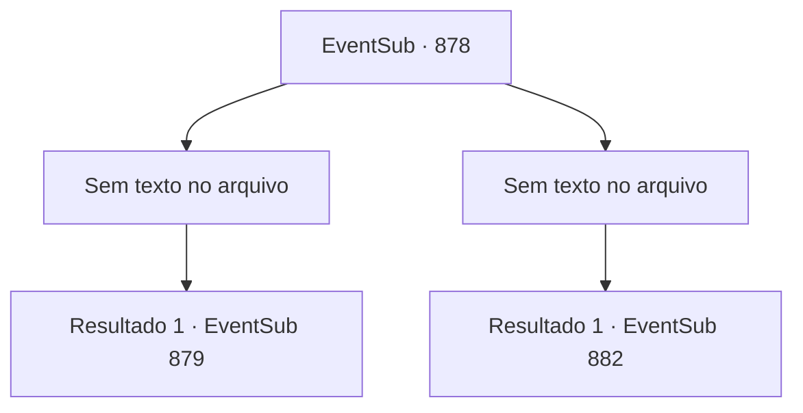

# Eventos secundários · 878

[Índice da tabela](index.md) · [Índice geral](../index.md)

ID: `pt:EventSub:878` · Fonte: `EventSub4` · Versão: 1.2.47.

Mapeamento estático dos arquivos; a disponibilidade e a execução dependem do estado da run.

## Texto do evento

*Sem texto no arquivo.*

## Dados de entrada

```json
{
  "id": 878,
  "grade": 1,
  "subEvent": "",
  "required": ""
}
```

## Mapa das escolhas



## Escolhas e resultados

### Escolha 1

*Sem texto no arquivo; o papel dessa opção depende da interface do jogo.*

Requisitos e outros campos da escolha:

```json
{
  "required": ""
}
```

#### Resultado 1.1

Uma brisa suave enche a arena. Você se aproxima de Shao, ajoelhada no chão, estendendo as mãos para ela. Depois de olhar para elas por alguns segundos, ela as agarra firmemente. 

 "...Eu perdi. Você... é forte."

 Seu nome ecoa pela arena. Você é o vencedor do torneio! A cidade inteira parece estar tremendo com a celebração. 

 "O novo Mestre de Batalha é... {1}!!"

 O Sultão de Gladio e o Sumo Sacerdote de Batt levantam seus braços no ar, declarando sua vitória. Junto com o título vem um grande prêmio em dinheiro, e você é aplaudido e adorado pela multidão. Você acena para responder aos seus favores.

Continuação registrada: [Evento 879](0879.md) na mesma tabela.

```json
{
  "required": "",
  "chance": "1",
  "nextEvent": 879,
  "type": 2,
  "reward": "1_4_300|1_5_1|14_11_1"
}
```

### Escolha 2

*Sem texto no arquivo; o papel dessa opção depende da interface do jogo.*

Requisitos e outros campos da escolha:

```json
{
  "required": ""
}
```

#### Resultado 2.1

Infelizmente, você é derrotado por Shao.   Uma brisa suave enche a arena.   Shao se aproxima de você, ajoelhada no chão, mas não estende a mão.   

 "Tenho certeza de que você consegue se levantar sozinho, hm?"

   Você acena com a cabeça em resposta e lentamente se levanta.   <link=shake>

 "WOOOOOOOOO!!!"

</link>   O nome de Shao ecoa pela arena.   A cidade inteira parece estar tremendo com a celebração.   

 "O novo Mestre de Batalha é... Shao do Clã Ryu!"

   O Sultão de Gladio e o Sumo Sacerdote de Batt levantam seus braços no ar, declarando sua vitória.   Shao faz sua própria saudação oriental em resposta.   Você observa a cena se desenrolar, depois vai embora imediatamente.

Continuação registrada: [Evento 882](0882.md) na mesma tabela.

```json
{
  "required": "",
  "chance": "1",
  "nextEvent": 882,
  "type": 2,
  "reward": ""
}
```

## Referências que chegam a este evento

- [Evento 876 · escolha 1 · resultado 2](0876.md#escolha-1)
- [Evento 877 · escolha 1 · resultado 1](0877.md#escolha-1)
- [Evento 877 · escolha 2 · resultado 1](0877.md#escolha-2)
