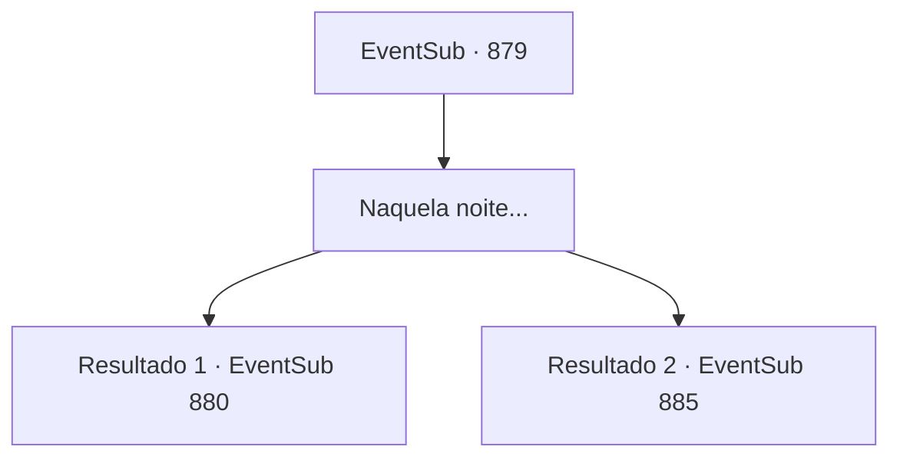

# Eventos secundários · 879

[Índice da tabela](index.md) · [Índice geral](../index.md)

ID: `pt:EventSub:879` · Fonte: `EventSub4` · Versão: 1.2.47.

Mapeamento estático dos arquivos; a disponibilidade e a execução dependem do estado da run.

## Texto do evento

*Sem texto no arquivo.*

## Dados de entrada

```json
{
  "id": 879,
  "grade": 1,
  "subEvent": "",
  "required": ""
}
```

## Mapa das escolhas



## Escolhas e resultados

### Escolha 1

Naquela noite...

Requisitos e outros campos da escolha:

```json
{
  "required": ""
}
```

#### Resultado 1.1

O torneio pode ter acabado, mas o festival continua. Todos estão ocupados aproveitando as festividades, falando sobre o torneio, bebendo ou se envolvendo em um duelo. Enquanto você anda pelas ruas se misturando com os locais, Shao se aproxima de você. 

 "É um dia agradável, afinal. Acho que posso te dar a honra de... passar um tempo comigo."

 Shao agarra seu braço e te puxa para um beco próximo, onde há menos pessoas. Então, te dando um olhar intrigante, ela abre a boca. 

 "Eu estarei voltando para minha cidade natal agora. Isso significa que nunca mais voltarei para este lugar distante. Mas antes de partir, estou aqui para cumprir minha promessa. Posso te dar qualquer coisa que você queira... é só dizer a palavra."


Continuação registrada: [Evento 880](0880.md) na mesma tabela.

```json
{
  "required": "5_738_2",
  "chance": "1",
  "nextEvent": 880,
  "type": 2,
  "reward": ""
}
```

#### Resultado 1.2

O torneio pode ter acabado, mas o festival continua. Todos estão ocupados aproveitando as festividades, falando sobre o torneio, bebendo ou se envolvendo em um duelo. Enquanto você anda pelas ruas se misturando com os locais, Lei se aproxima de você. Ele está visivelmente cansado de navegar pela multidão agitada. 

 "Ufa, você não tem ideia de quanto tempo procurei por você, Sohyeop. Posso te convidar para uma bebida?"


Continuação registrada: [Evento 885](0885.md) na mesma tabela.

```json
{
  "required": "18_738_2",
  "chance": "1",
  "nextEvent": 885,
  "type": 2,
  "reward": ""
}
```

## Referências que chegam a este evento

- [Evento 878 · escolha 1 · resultado 1](0878.md#escolha-1)
